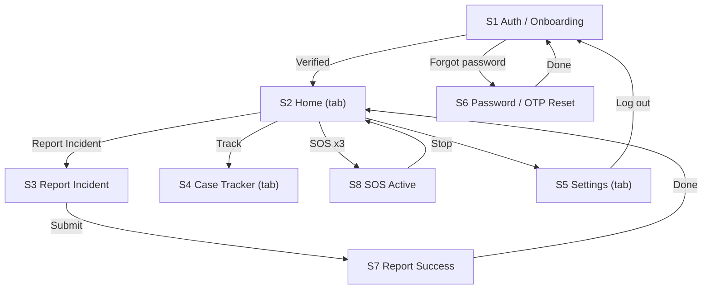

# IMPLEMENTATION_PLAN.md: ConnectTransit SA

> Built from `docs/PRD.md` **v1.1.0**, `docs/DESIGN.md`, the Stitch designs, and the decisions recorded in Section 18. The changes this plan needed from PRD v1.0.0 are now in PRD v1.1.0 (Section 20). **Where this plan and the PRD disagree, stop and ask the human (rule 6 in Section 2).**

---

## 0. Plan details

| Field | Value |
| --- | --- |
| App name | ConnectTransit SA (see Section 18 #1) |
| Built from PRD version | v1.1.0 |
| Screen designs | Stitch project `13706398669649661414`; PNG exports to be placed in `docs/designs/` (one file per screen ID); design tokens in `docs/DESIGN.md`; designs for S1–S7, A1 and A2 were shown in chat on 6 Nov 2026 and must be saved as PNG files before Phase 1 (Section 18 #28) |
| Plan version | v1.1 |
| Repository | github.com/NyikoVumani/ConnectTransit-SA |
| Status | Waiting on open items in Section 18 (see "Starts when" in each phase) |
| Last updated | 6 Nov 2026 |

---

## 1. Start here (instructions for the coding agent)

Before writing any code:

1. Read this whole file from top to bottom.
2. Read `docs/PRD.md` and `docs/DESIGN.md`.
3. Look at the screen designs in `docs/designs/` listed in Section 7.3. If a screen has no design file, build it from `docs/DESIGN.md` using the shared components, then tell the human it needs a design review.
4. Check Section 18. Each **Open** item says which phase it blocks. If an item blocks the phase you were asked to start, stop and ask the human. Do not start.
5. Check that the prerequisites in Section 4.2 are installed.
6. Start **Phase 1 only**. Follow Section 2 at all times.

---

## 2. Rules for the coding agent (copy word for word, do not edit)

1. **One phase at a time.** Only work on the phase the human asked for. When that phase's Definition of Done is complete, stop and wait for the human to say "Start Phase <number>".
2. **Test-driven development (TDD) for every task.** Follow the cycle in Section 12.1:
    - Write the test.
    - Run it and see it fail for the right reason.
    - Write the smallest code that makes it pass.
    - Run all tests.
    - Refactor while all tests still pass.
3. **Never cheat a test.** Never delete, skip, weaken or change a test just to make it pass. If you believe a test is wrong, stop and explain why to the human.
4. **Never break earlier work.** Every test from earlier phases must still pass before a phase is done.
5. **Build only what is planned.** Build only what is in this file and `docs/PRD.md`. Never build anything in Section 3.3 (Deferred).
6. **Ask, don't guess.** If anything is missing, unclear or contradictory, stop, add it to Section 18, and ask the human.
7. **Match the designs.** Every screen must match its design in Section 7.3: layout, order, labels, text, colours and spacing. Use the design tokens in Section 7.1. Never hard-code colours, font sizes or spacing.
8. **Every state, every screen.** Each screen must handle every state listed for it in Section 7.3 (chosen from normal, empty, loading, error, offline, success, plus any screen-specific states).
9. **Exact wording.** Use the exact labels and messages from the PRD and from Section 10. Never invent wording.
10. **Security first.**
    - Never put secret keys in app code, logs, test files or Git.
    - Every permission rule in Section 9 must be enforced on the server or database, never only in the app.
    - Every permission rule must have a test.
    - Never return `reports.reporter_id`, `users.full_name`, `users.phone_number`, `users.email`, `users.home_address` or any `user_private` column to a Transport Admin or to another commuter (BR1).
11. **Full check before "done".** Run the full check command (Section 4.3) before saying a phase is done, then add a short summary of the results to the Progress log (Section 17).
12. **Record your progress.** After each phase:
    - tick the checkboxes for that phase in this file;
    - add a row to the Progress log;
    - commit using the commit message given in the phase.
13. **No surprise libraries.** Do not add, remove or upgrade any library or tool not listed in Section 4.1 without asking the human first.
14. **Stuck rule.** If the same problem is still failing after 3 attempts, stop and report:
    - what you tried;
    - the exact error;
    - what you need from the human.
15. **Clean code.** Follow the folder structure in Section 5. Use the PRD's key terms (Section 3.4) for names in code. Keep files small and focused.

---

## 3. Project summary and scope

### 3.1 Summary

ConnectTransit SA lets South African commuters report transport incidents (with plate, photos, video, audio) to verified transport organizations, track the outcome using a case reference number or a vehicle plate, and trigger an emergency SOS with live GPS. Transport Admins see reports with all commuter details removed (Identity Masking). Severe cases (Sexual Misconduct, Physical Assault) are automatically sent to SAPS.

**Platforms:**
- Commuter app: Android first (React Native with Expo). iPhone is deferred.
- Admin, SAPS and System Admin portals: one web app (Next.js on Vercel).

**Language:** English only in v1 (Section 18 #7).

### 3.2 Features in scope

| ID | Feature | Priority | Built in phase |
| --- | --- | --- | --- |
| F1 | Incident reporting and evidence upload | Must | 4 |
| F2 | Anonymous routing engine (Identity Masking + SAPS escalation) | Must | 2, 4, 7 |
| F3 | Case status and rationale tracker (by reference number or plate; answers admin evidence requests) | Must | 5, 6 |
| F4 | Silent SOS (in-app trigger, see Section 18 #16) | Must | 8 |
| F5 | Admin disciplinary portal (web), including requests for further evidence | Must (raised from Should, Section 18 #3) | 6 |
| F6 | Multi-language localization | Deferred (English only) | — |
| F7 | SAPS portal and System Admin portal (web) | Must (new, Section 18 #5) | 7 |

### 3.3 Deferred: do NOT build

- iPhone build
- Languages other than English (F6); the app still keeps all text in `messages.ts` so translation can be added later
- Real hardware power-button trigger for SOS (PRD F8; F4 native module, a later release)
- SOS emergency contacts and the SOS cancel PIN (skipped, Section 18 #13)
- Offline Bluetooth mesh sync (PRD F9), public safety heatmaps (PRD F10)
- In-app payments or ticket booking; driver-passenger chat
- Biometrics replacing the password (biometrics only unlock the saved session)
- Users without a South African ID number (Section 18 #19)
- Dark mode
- Changing email or phone number

### 3.4 Key terms (use these names in code)

| Term (PRD 1.7) | Name in code | Meaning |
| --- | --- | --- |
| Commuter | `commuter` (role) | Passenger who reports or triggers SOS |
| Transport Admin | `transport_admin` (role) | Reviews cases for one organization |
| SAPS / Emergency Authority | `saps` (role) | Sees escalated cases and SOS events |
| System Admin | `system_admin` (role) | Manages organizations and admin accounts |
| Incident Report | `Report`, table `reports` | One complaint |
| Case Reference Number | `case_ref` | e.g. `TC-2026-0042` (BR7) |
| Silent SOS | `SosEvent`, table `sos_events` | One emergency session with live GPS |
| Identity Masking | `admin_case_view` | Database view that leaves out all commuter fields (BR1) |
| Oversight Queue | `oversight_queue` | Reports sent to "Other/Unregistered" waiting for a System Admin to tag a real organization |

---

## 4. Tech stack, prerequisites and commands

### 4.1 Stack

| Layer | Tool | Version | Used for |
| --- | --- | --- | --- |
| Commuter app | React Native + Expo, Expo Router | Latest stable Expo SDK at setup (PRD says v51+) | Screens S1–S8 |
| Web portals | Next.js (App Router) | Latest stable | A1–A7, P1 |
| Language | TypeScript (strict mode) | Bundled | All app, web, test and script code |
| Styling (app) | NativeWind | Version supporting the chosen Expo SDK | Styling using tokens |
| Styling (web) | Tailwind CSS | Version required by Next.js | Same tokens as the app |
| Fonts | `@expo-google-fonts/inter` (app), `next/font` Inter (web) | Latest | Inter |
| Media | `expo-image-picker`, `expo-image-manipulator`, `expo-audio` | Bundled with Expo SDK | Photos, video, voice notes |
| Location | `expo-location`, `expo-task-manager` | Bundled with Expo SDK | Incident location, SOS live GPS |
| Offline drafts | `expo-sqlite` | Bundled with Expo SDK | Report draft cache (edge case in PRD 6.2) |
| Biometric sign-in | `expo-local-authentication` | Bundled with Expo SDK | Unlocks the saved session with fingerprint or face (Section 11) |
| Secure session | `expo-secure-store` | Bundled with Expo SDK | Keeps the session in Keystore (PRD Section 5) |
| Push | `expo-notifications` | Bundled with Expo SDK | Case update push (Section 18 #12) |
| Network status | `@react-native-community/netinfo` | Latest | Offline banner |
| Data fetching | `@tanstack/react-query` | v5 | Loading, caching, retries |
| IDs on the phone | `expo-crypto` | Bundled with Expo SDK | `Crypto.randomUUID()` for report ids |
| NativeWind dependencies | `tailwindcss`, `react-native-reanimated` | Versions NativeWind requires | Needed by NativeWind |
| Backend client | `@supabase/supabase-js` v2 (app), `@supabase/ssr` (web) | Latest | Talking to Supabase |
| Backend and database | Supabase: PostgreSQL 15, Auth, Storage, Cron (pg_cron), Database Webhooks (pg_net) | Supabase CLI latest | Data, sign-in, evidence files, scheduled jobs |
| Server functions | Supabase Edge Functions (Deno) | Supabase CLI latest | `send-sms-otp`, `dispatch-notification`, `dispatch-saps`, `delete-account`, `create-admin-user`, `sos-start` |
| SMS | Clickatell (REST API) | — | OTP SMS (through Supabase's Send SMS hook) and case-update SMS |
| Maps (web) | Leaflet + OpenStreetMap tiles | Latest | SAPS live SOS map, public live location page (no API key) |
| Unit and component tests | Jest (`jest-expo` preset) + React Native Testing Library; Jest + React Testing Library for `web/` | Latest | Rules, components, screens |
| Database and permission tests | pgTAP via `supabase test db` | Supabase CLI | Tables, triggers, RLS |
| Integration tests | Jest + `supabase-js` against the local Supabase | — | Operations OP1–OP29 |
| Mobile end-to-end tests | Maestro | Latest | Commuter flows on an Android emulator |
| Web end-to-end tests | Playwright | Latest | Admin, SAPS, System Admin flows |
| Lint and type check | ESLint, `tsc` | Bundled | Code quality |
| Secret scan | secretlint | Latest | Finds keys accidentally committed (T-NFR-6) |
| Build | Expo EAS Build (Android APK), Vercel (web) | Latest | Demo and release |
| Runtime | Node.js | 24 LTS | Running tools; runs `.ts` scripts directly |

Install Expo packages with `npx expo install <package>` so their versions match the Expo SDK.

### 4.2 Prerequisites on the computer

- [ ] Node.js 24 LTS and npm
- [ ] Git and a GitHub account
- [ ] Docker Desktop, running (the local Supabase needs it)
- [ ] Android Studio with one Android emulator (for E2E tests and the development build)
- [ ] An Android phone with Expo Go (for daily manual testing; the SOS background location test needs the development build instead)
- [ ] Maestro CLI installed
- [ ] Playwright browsers installed (`npx playwright install`)
- [ ] Accounts: Supabase (hosted projects, region AWS Cape Town `af-south-1`), Expo (EAS Build), Vercel (web), Clickatell (SMS; see Section 18 #18)

### 4.3 Commands

| Purpose | Command |
| --- | --- |
| Install dependencies | `npm install` in the repo root, `mobile/` and `web/` |
| Start the local backend | `npx supabase start` |
| Reset the database (migrations + seed) | `npx supabase db reset` then `npm run seed:storage` (= `node --env-file=.env scripts/seed-storage.ts`) |
| Serve server functions locally | `npx supabase functions serve --env-file supabase/.env.local` |
| Start the commuter app | `cd mobile && npx expo start` |
| Start the web portals | `cd web && npm run dev` |
| Unit and component tests (app) | `cd mobile && npm test` (= `jest --testPathIgnorePatterns tests/integration`) |
| Unit and component tests (web) | `cd web && npm test` |
| Database and permission tests | `npx supabase test db` |
| Integration tests | `npm run test:integration` (= `node --env-file=.env node_modules/jest/bin/jest.js -c jest.integration.config.js`) |
| Mobile E2E tests | `cd mobile && npx expo run:android` (once per change), then `maestro test -e SEED_TEST_PASSWORD=$SEED_TEST_PASSWORD .maestro/` |
| Web E2E tests | `cd web && npx playwright test` |
| Lint | `npm run lint` (runs lint in `mobile/` and `web/`) |
| Type check | `npm run typecheck` (runs `tsc --noEmit` in both) |
| **Full check (run before every "done")** | `npm run check` (runs lint, type check, both unit and component test suites, `supabase test db` and `test:integration`). `npx supabase start` must be running and Edge Functions served. |
| Build the app | `cd mobile && npx eas-cli build -p android --profile preview` (`eas.json` has a `preview` profile with `"android": { "buildType": "apk" }`) |
| Build the web app | `cd web && npm run build` (Vercel runs this on deploy) |

E2E tests (Maestro and Playwright) run at the end of each feature phase and in Phase 9. They are not part of `npm run check`.

---

## 5. Folder structure

```
connecttransit-sa/
  mobile/                           Commuter app (Expo)
    app/                            Screens (Expo Router: one file per screen)
      _layout.tsx                   Root layout: fonts, providers, auth redirects (Section 11)
      (auth)/welcome.tsx            S1 Auth / Onboarding
      (auth)/reset-password.tsx     S6 Password / OTP Reset
      (tabs)/_layout.tsx            Tab bar (Home, Track, Settings)
      (tabs)/index.tsx              S2 Home Dashboard
      (tabs)/track.tsx              S4 Case Tracker
      (tabs)/settings.tsx           S5 Settings and Profile
      report/new.tsx                S3 Report Incident
      report/success.tsx            S7 Report Success
      sos/active.tsx                S8 SOS Active
    components/                     Shared components (Section 7.2)
    lib/
      supabase.ts                   Supabase client (public key only)
      api/                          One file per operation group (Section 10)
      rules/                        Pure business-rule functions (BR#), no network
      db/drafts.ts                  SQLite report drafts
      messages.ts                   Every user-facing message, in one place
      biometric.ts                  Biometric unlock of the saved session (expo-local-authentication)
    theme/tokens.ts                 Design tokens (Section 7.1)
    tests/                          unit/, components/, integration/
    .maestro/                       Mobile E2E flows
  web/                              Next.js portals
    app/
      login/page.tsx                A7 Portal Login
      admin/page.tsx                A1 Admin Case Dashboard
      admin/cases/[id]/page.tsx     A2 Case Resolution
      saps/page.tsx                 A3 SAPS Escalation Queue
      saps/sos/page.tsx             A4 SAPS Live SOS
      system/organizations/page.tsx A5 Organizations and Admin Accounts
      system/oversight/page.tsx     A6 Oversight Queue
      live/[token]/page.tsx         P1 Public live location page
    components/  lib/  theme/tokens.ts  tests/  e2e/
  supabase/
    migrations/                     SQL migrations (Section 8.6)
    functions/                      Edge Functions (Section 10)
    tests/                          pgTAP tests (T-SEC, T-BR, T-DB)
    seed.sql                        Seed rows (Section 8.7)
    config.toml
  scripts/seed-storage.ts           Uploads seed evidence files (uses the secret key; never in the apps)
  docs/PRD.md  docs/DESIGN.md  docs/designs/
  IMPLEMENTATION_PLAN.md  .env.example  README.md
```

**Rule:** a new folder may only be created if it is added to this section first.

---

## 6. Environment variables and secrets

| Name | What it is | Where to get it | Public or secret | Used by |
| --- | --- | --- | --- | --- |
| `EXPO_PUBLIC_SUPABASE_URL` | Supabase address as the phone sees it | Local on a real phone: `http://<computer Wi-Fi IP>:54321`. Emulator: `http://10.0.2.2:54321`. Hosted: dashboard | Public | Commuter app |
| `EXPO_PUBLIC_SUPABASE_ANON_KEY` | Public (anon) key | Same | Public (safe only because every table and bucket has RLS) | Commuter app |
| `NEXT_PUBLIC_SUPABASE_URL` / `NEXT_PUBLIC_SUPABASE_ANON_KEY` | Same two values for the web app | Same | Public | Web app |
| `SUPABASE_URL` | Supabase address as the computer sees it (`http://127.0.0.1:54321`) | `npx supabase status` | Public | Integration tests and scripts only |
| `SUPABASE_SERVICE_ROLE_KEY` | Admin (service role) key | Same | **Secret** | `scripts/seed-storage.ts` and integration tests only. Edge Functions get it from Supabase automatically. |
| `SEED_TEST_PASSWORD` | Password for all seed test accounts | You choose it | **Secret** | Seed script, integration tests, Maestro, Playwright |
| `CLICKATELL_API_KEY` | Clickatell API key | Clickatell account | **Secret** | Edge Function secrets only (`npx supabase secrets set`) |
| `SEND_SMS_HOOK_SECRET` | Secret Supabase uses to sign the Send SMS hook call | Supabase dashboard (Auth hooks) | **Secret** | Edge Function `send-sms-otp` only |
| `SAPS_WEBHOOK_URL` / `SAPS_WEBHOOK_SECRET` | Address SAPS escalations are posted to, and the key used to sign them | Provided by SAPS or the human (Section 18 #8). Local: a mock receiver | **Secret** | Edge Function `dispatch-saps` only |

`.env.example`:

```
EXPO_PUBLIC_SUPABASE_URL=http://192.168.1.10:54321
EXPO_PUBLIC_SUPABASE_ANON_KEY=replace-with-anon-key
NEXT_PUBLIC_SUPABASE_URL=http://127.0.0.1:54321
NEXT_PUBLIC_SUPABASE_ANON_KEY=replace-with-anon-key
SUPABASE_URL=http://127.0.0.1:54321
SUPABASE_SERVICE_ROLE_KEY=replace-with-service-role-key-never-commit
SEED_TEST_PASSWORD=replace-with-a-test-only-password
```

Edge Function secrets go in `supabase/.env.local` (git-ignored) locally and `npx supabase secrets set` when hosted:

```
CLICKATELL_API_KEY=replace-never-commit
SEND_SMS_HOOK_SECRET=replace-never-commit
SAPS_WEBHOOK_URL=http://host.docker.internal:4010/saps
SAPS_WEBHOOK_SECRET=replace-never-commit
```

Rules:

- Real values go in `.env` and `supabase/.env.local`, both listed in `.gitignore` and never committed.
- Only variables starting with `EXPO_PUBLIC_` may be used in `mobile/app`, `mobile/components` or `mobile/lib`, and only `NEXT_PUBLIC_` ones in browser code in `web/`. A test (T-NFR-6) fails if `SERVICE_ROLE`, `CLICKATELL` or `SAPS_WEBHOOK` appears there.
- If a new variable is needed, add it here and to the example files first.

---

## 7. Design system and screens

Source: `docs/DESIGN.md`. **Where its YAML colour block and its written palette disagree, the written palette is used** (it matches PRD 9.1). Section 18 #26 records this.

### 7.1 Design tokens (`mobile/theme/tokens.ts` and `web/theme/tokens.ts`, identical values)

| Token | Value | Notes |
| --- | --- | --- |
| `color.primary` | #0B7A6B | Primary actions, verified, authenticated |
| `color.warning` | #D97706 | Advisory, secondary button background |
| `color.info` | #0E7490 | GPS telemetry, informational banners |
| `color.danger` | #DC2626 | SOS and errors only |
| `color.success` | #059669 | Resolved cases, success feedback |
| `color.background` | #F8FAFC | Screen canvas |
| `color.surface` | #FFFFFF | Cards, inputs |
| `color.text` | #0F172A | Main text |
| `color.textMuted` | #64748B | Helper text, placeholders |
| `color.border` | #E2E8F0 | Card and input borders, dividers |
| `color.borderStrong` | #CBD5E1 | Dropdowns, sheets, modals |
| `color.onWarning` | #0F172A | Text on amber buttons (white on #D97706 fails 4.5:1; Section 18 #27) |
| `font.family` | Inter | All text |
| `font.h1` / `h2` / `h3` | 24/32 bold (−0.02em); 20/28 semibold (−0.01em); 16/24 semibold | px size/line-height |
| `font.body` / `caption` | 14/20 regular; 12/16 regular (+0.01em) | |
| `font.label` / `labelSmall` | 14/20 semibold; 12/16 semibold | |
| `font.micro` | 10/14 bold, uppercase, +0.05em | Status chips |
| `space.1` … `space.6` | 8 / 16 / 24 / 32 / 48 (and 4 for tight gaps) | 8px scale; screen margin and gutter 16 |
| `radius.card` / `radius.input` | 8 | |
| `radius.pill` | 24 | Buttons, chips |
| `size.touchMin` | 48 | All tappable areas |
| `size.button` / `size.sosButton` | 48 / 56 | |
| `size.input` | 48 | Padding 12 16 |
| `size.row.single` / `row.double` | 56 / 72 | List rows |
| `size.chip` | 28 | Height |
| `shadow.card` | 0 1px 3px rgba(15,23,42,0.06) | Optional |
| `shadow.sheet` | 0 4px 12px rgba(15,23,42,0.12) | Level 2 |
| `shadow.sos` | 0 8px 24px rgba(220,38,38,0.25) | Level 3 |
| `layout.maxWidth.console` | 720 | Web portals at 1024px and wider |

### 7.2 Shared components

| Component | File | Variants and states | Used on | Tests |
| --- | --- | --- | --- | --- |
| Button | `components/Button.tsx` | primary, secondary (amber), outlined, sos (56px); disabled; loading | All | T-C-1 |
| TextField | `components/TextField.tsx` | normal, focused (2px primary border), error (2px red border + 12px caption); password with eye toggle | S1, S3, S4, S6 | T-C-2 |
| Select | `components/Select.tsx` | dropdown for organization and category; shows "Other/Unregistered" | S3 | T-C-3 |
| Card | `components/Card.tsx` | white, 1px border, 4px left accent (green verified, amber investigating, red hazard) | S2, S4, A1 | T-C-4 |
| StatusChip | `components/StatusChip.tsx` | Submitted, Under Review, Escalated, Resolved, Dismissed; micro text | S2, S4, A1, A2 | T-C-5 |
| StatusTimeline | `components/StatusTimeline.tsx` | Submitted → Under Review → Decision Published | S4, A2 | T-C-6 |
| OfflineBanner | `components/OfflineBanner.tsx` | "Network connection lost. Your report draft has been saved locally." on S3; "You're offline." elsewhere | All logged-in screens | T-C-7 |
| EmptyState | `components/EmptyState.tsx` | text and optional button | S2, S4, A1 | T-C-8 |
| Skeleton | `components/Skeleton.tsx` | line, card placeholders | S2, S4, A1 | T-C-9 |
| MediaPicker | `components/MediaPicker.tsx` | photo (max 3), video (1), audio (1); shows size errors | S3 | T-C-10 |
| OtpInput | `components/OtpInput.tsx` | 6 boxes, resend timer | S1, S6 | T-C-11 |
| SosButton | `components/SosButton.tsx` | idle, armed (1 or 2 taps), sending | S2 | T-C-12 |
| TabBar | `mobile/app/(tabs)/_layout.tsx` | 3 icons (Home, Track, Settings); active filled | S2, S4, S5 | T-C-13 |
| ConfirmModal | `components/ConfirmModal.tsx` | title, text, danger or primary button, cancel | S5 (log out, delete account) | T-C-14 |
| DataTable (web) | `web/components/DataTable.tsx` | sortable columns, row click | A1, A3, A5, A6 | T-C-15 |

### 7.3 Screens

"Design" column: **PNG** means a Stitch export is expected in `docs/designs/` (shown in chat on 6 Nov 2026 but not yet saved as files in the repo, Section 18 #28). **None** means the screen is not in the PRD inventory or has no design; build from `docs/DESIGN.md` and flag for design review.

**Designs are a guide, not the final word.** Several designs disagree with PRD v1.1 (PRD Section 14 lists the changes still needed). Where they disagree, follow PRD v1.1 and write "needs design update" next to that screen in the Progress log. **Never build the "QA state inspector" panels** at the bottom of every Stitch screen; they are prototype tools. Build the states they show (normal, empty, loading, error, offline, success) as real, testable states. Placeholder data in the designs (CRN-2025-08491, fleet names, fines, jurisdictions) is sample content only.

| ID | Screen | Route / file | Design | Who can open it (else redirect to) | Tab bar | Required states | Phase |
| --- | --- | --- | --- | --- | --- | --- | --- |
| S1 | Auth / Onboarding | `/welcome` | `S1.png` | Logged out (else S2) | No | Normal, Error, Offline, Success (OTP sent), Create account step, Biometric prompt | 3 |
| S2 | Home Dashboard | `/` (tabs) | `S2.png` | Logged-in commuter | Yes | Normal, Empty (no cases), Loading, Error, Offline | 3 (shell), 4 (report button, cases), 8 (SOS) |
| S3 | Report Incident | `/report/new` | `S3.png` | Logged-in commuter | No | Normal, Error (field errors), Uploading, Offline (draft saved), Success | 4 |
| S4 | Case Tracker | `/track` (tabs) | `S4.png` | Logged-in commuter | Yes | Normal (my cases / search), Empty, Loading, Error, Offline, Not found, Evidence requested | 5, 6 |
| S5 | Settings and Profile | `/settings` (tabs) | `S5.png` | Logged-in commuter | Yes | Normal, Error, Offline, Delete confirmation | 3 |
| S6 | Password / OTP Reset | `/reset-password` | `S6.png` | Logged out | No | Normal, Error, Offline, Success | 3 |
| S7 | Report Success | `/report/success` | `S7.png` | Logged-in commuter | No | Normal | 4 |
| S8 | SOS Active | `/sos/active` | None (not in PRD inventory) | Logged-in commuter with an active SOS | No | Active, Stopping, Error, Offline (queued) | 8 |
| A7 | Portal Login | `/login` | None | Logged out (else role home) | No | Normal, Error, Offline | 6 |
| A1 | Admin Case Dashboard | `/admin` | `A1.png` | `transport_admin` | No | Normal, Empty, Loading, Error, Offline | 6 |
| A2 | Admin Case Resolution | `/admin/cases/[id]` | `A2.png` | `transport_admin` of that organization | No | Normal, Saving, Error, Offline, Success, Evidence request form | 6 |
| A3 | SAPS Escalation Queue | `/saps` | None | `saps` | No | Normal, Empty, Loading, Error, Offline | 7 |
| A4 | SAPS Live SOS | `/saps/sos` | None | `saps` | No | Normal, Empty, Loading, Error, Offline | 8 |
| A5 | Organizations and Admin Accounts | `/system/organizations` | None | `system_admin` | No | Normal, Saving, Error, Offline | 7 |
| A6 | Oversight Queue | `/system/oversight` | None | `system_admin` | No | Normal, Empty, Loading, Error, Offline | 7 |
| P1 | Live Location (public) | `/live/[token]` | None | Anyone with the link while the SOS is active or for 24 hours | No | Live, Ended, Not found | 8 |

---

## 8. Data model and database

All tables live in the `public` schema. `users.id` equals the Supabase Auth user id. "Cascade" means the row is deleted when the row it points to is deleted. The PRD's `media_urls` array is replaced by a `report_media` table (Section 18 #29).

### 8.1 Tables

**Table: `users`**: public-safe profile row, one per account.

| Column | Type | Null? | Default | Constraints | Notes |
| --- | --- | --- | --- | --- | --- |
| id | uuid | No | — | primary key; foreign key → `auth.users.id` on delete cascade | Created by a trigger on sign-up |
| role | text | No | 'commuter' | check in (commuter, transport_admin, saps, system_admin) | Only the service role or a System Admin function can change it |
| full_name | text | No | — | length 1–100 | Removed on account delete (set to "Deleted user") |
| email | text | Yes | — | unique; lower-case check | Cleared on delete |
| phone_number | text | Yes | — | unique; check `~ '^\+27[0-9]{9}$'` | Cleared on delete |
| preferred_language | text | No | 'en' | check = 'en' in v1 | Column kept so more languages can be added |
| created_at | timestamptz | No | now() | | |

**Table: `user_private`**: sensitive data, never readable through the API.

| Column | Type | Null? | Constraints | Notes |
| --- | --- | --- | --- | --- |
| user_id | uuid | No | primary key; → users cascade | |
| id_number | text | No | unique; check `~ '^[0-9]{13}$'` | South African ID number (BR6). Deleted with the account |
| created_at | timestamptz | No | default now() | |

No policy and no column grant exist for `anon` or `authenticated` on this table (SEC2).

**Table: `organizations`**

| Column | Type | Null? | Default | Constraints | Notes |
| --- | --- | --- | --- | --- | --- |
| id | uuid | No | gen_random_uuid() | primary key | |
| name | text | No | — | unique; length 1–150 | e.g. DORLJOTA |
| type | text | No | — | check in (Taxi, Bus, E-Hailing) | |
| is_verified | boolean | No | true | check: true unless `is_oversight` | |
| is_oversight | boolean | No | false | | The one "Other/Unregistered" row (Section 18 #10) |

Reports cannot be left pointing at a deleted organization (`on delete restrict`).

**Table: `org_admins`**: user_id → users (cascade); organization_id → organizations (restrict). Primary key (user_id). A Transport Admin belongs to exactly one organization.

**Table: `reports`**

| Column | Type | Null? | Default | Constraints | Notes |
| --- | --- | --- | --- | --- | --- |
| id | uuid | No | — | primary key | Generated on the phone (`Crypto.randomUUID()`) |
| case_ref | text | No | — | unique | Set by trigger (BR7) |
| reporter_id | uuid | Yes | auth.uid() | → users on delete set null | Never exposed except to the reporter (SEC5) |
| organization_id | uuid | No | — | → organizations (restrict) | |
| unlisted_entity_name | text | Yes | — | length 1–150; required when the organization is the oversight row | |
| vehicle_plate | text | No | — | length 1–15 | As typed |
| plate_normalized | text | No | generated | upper-case, spaces and dashes removed | Used for search (BR8) |
| category | text | No | — | check in the list in 8.1a | |
| custom_category_text | text | Yes | — | length 1–100; required when category is 'Other' | |
| description | text | No | — | length 1–2000 | |
| incident_at | timestamptz | No | — | not in the future | |
| location_lat / location_lng | double precision | Yes | — | valid ranges | From the phone; optional if permission is denied |
| location_text | text | Yes | — | length ≤ 200 | |
| saps_case_number | text | Yes | — | length ≤ 30 | Optional, from the reporter |
| status | text | No | 'Submitted' | check in (Submitted, Under Review, Escalated, Resolved, Dismissed) | BR10 |
| is_escalated | boolean | No | false | | Set by trigger for severe categories (BR2) |
| admin_decision | text | Yes | — | length ≤ 200 | |
| decision_reasoning | text | Yes | — | length ≥ 20 when status is Resolved or Dismissed (BR5) | |
| decided_at | timestamptz | Yes | — | | |
| created_at | timestamptz | No | now() | | |
| updated_at | timestamptz | No | now() | | |

**8.1a Categories (exact list, Section 18 #47; same as PRD 10.2):** Sexual Misconduct · Physical Assault · Reckless & Negligent Driving · Overcrowding & Safety Hazard · Extortion & Fare Intimidation · Overcharging · Harassment · Drunk or Impaired Driving · Unroadworthy Vehicle · Refusal of Service or Route Deviation · Other (needs `custom_category_text`). **Severe:** Sexual Misconduct, Physical Assault.

**Table: `report_media`**: id uuid primary key; report_id → reports (cascade); kind in (photo, video, audio); storage_path text (`evidence/{report_id}/{file}`); size_bytes integer; duration_seconds integer (video and audio only); created_at. A trigger enforces BR4 (3 photos, 1 video, 1 audio; sizes and durations). `request_id` uuid null → `evidence_requests` (set null): set when the file answers an evidence request. The BR4 limits are counted separately for the original report (request_id null) and for each request.

**Table: `evidence_requests`** (BR12): id uuid primary key; report_id → reports (cascade); message text (length 20–500); status in (open, answered, cancelled, closed_by_decision); requested_by uuid → users (set null; never returned to the commuter); reply_note text null (length ≤ 500); created_at; answered_at. A trigger enforces one open request per report and at most 3 requests per report, and that the report is Under Review or Escalated when the request is created.

**Table: `sos_events`**: id uuid primary key; user_id → users (set null); share_token text unique (random, 32 characters); status in (active, stopped); started_at; stopped_at; last_lat, last_lng, last_recorded_at; used_cached_location boolean; dispatch_ms integer (time from trigger to saved row, for G2).

**Table: `sos_locations`**: id; sos_event_id → sos_events (cascade); lat; lng; recorded_at. Rows older than 24 hours are deleted by a job (8.5).

**Table: `saps_queue`**: id; kind in (report, sos); report_id → reports (set null); sos_event_id → sos_events (set null); payload jsonb; status in (new, acknowledged); webhook_status in (pending, sent, failed); webhook_attempts integer; created_at; `purge_after` timestamptz null (set to 12 months after the commuter deletes the account, BR13).

**Table: `notification_outbox`**: id; user_id → users (cascade); report_id; channel in (push, sms); body text; status in (pending, sent, failed); created_at. Text follows PRD 4.5 exactly.

**Table: `push_tokens`**: user_id → users (cascade); token text; primary key (user_id, token).

**Table: `rate_events`**: user_id; kind in (report, plate_search); created_at. Used by the rate-limit rules (BR9).

### 8.2 Relationships and delete behaviour

- One organization has many reports and many Transport Admins.
- Deleting a report cascades to its media rows. Evidence files are kept unless the report is deleted.
- **Account deletion (PRD 6.2, Section 18 #15):** OP6 clears `users` PII (full_name → "Deleted user", email and phone → null), deletes `user_private`, `push_tokens`, `sos_events` and `sos_locations` for that user, and sets `reports.reporter_id` to null. Reports and their media stay, anonymised, because other people may need them. Then the Auth user is deleted. Open evidence requests on the person's reports are closed. Their `saps_queue` rows keep the SAPS copy but get `purge_after = now() + 12 months` (BR13); `purge_saps_pii()` removes the name and ID number from the payload after that date.
- Deleting `auth.users` cascades to `users`.

### 8.3 Status changes (BR10)

| From | To | Done by | Rule |
| --- | --- | --- | --- |
| (new) | Submitted | System | Default for non-severe categories |
| (new) | Escalated | Trigger | Severe categories (BR2) |
| Submitted | Under Review | Transport Admin | — |
| Escalated | Under Review | Transport Admin | — |
| Under Review / Escalated | Resolved or Dismissed | Transport Admin | Needs `admin_decision` and 20+ character `decision_reasoning` (BR5) |
| Resolved / Dismissed | any | Nobody | Final |

Any other change is rejected by a trigger.

### 8.4 Indexes

- `reports (organization_id, status, created_at desc)`: admin dashboard
- `reports (reporter_id, created_at desc)`: my cases
- `reports (plate_normalized)`: plate search
- `reports (is_escalated, created_at desc)`: SAPS queue
- `report_media (report_id)`
- `sos_locations (sos_event_id, recorded_at desc)`
- `saps_queue (status, created_at desc)`
- `rate_events (user_id, kind, created_at desc)`

### 8.5 Automatic jobs and triggers

| Name | Runs when | What it does | BR# | Test |
| --- | --- | --- | --- | --- |
| `handle_new_user` | After insert on `auth.users` | Creates the `users` and `user_private` rows from sign-up metadata (full_name, id_number); rejects an invalid ID (BR6) | BR6 | T-DB-1, T-BR6-2 |
| `set_case_ref` | Before insert on `reports` | Sets `case_ref` as `TC-YYYY-NNNN` using a per-year counter, padded to 4 digits (BR7) | BR7 | T-BR7-1 |
| `limit_reports` | Before insert on `reports` | Raises `rate_limit_reports` if the reporter has 5 reports in the last hour or 20 in the last day | BR9 | T-BR9-1 |
| `escalate_severe` | Before insert on `reports` | Sets status 'Escalated' and `is_escalated = true` for severe categories | BR2 | T-BR2-1 |
| `queue_saps_report` | After insert on `reports` | For escalated reports, inserts one `saps_queue` row (payload: case_ref, plate, category, description, location, `saps_case_number`, and the reporter's ID number and full name, the only place those leave the system) | BR2 | T-BR2-2 |
| `check_status_change` | Before update on `reports` | Applies the transitions in 8.3, BR5, and sets `updated_at` and `decided_at` | BR5, BR10 | T-BR5-1, T-BR10-1 |
| `check_evidence_request` | Before insert on `evidence_requests` | Enforces BR12 (case status, message length 20–500, one open request, at most 3 per case) | BR12 | T-BR12-1 |
| `close_requests_on_decision` | After update of `status` on `reports` | Sets open requests to `closed_by_decision` when the case becomes Resolved or Dismissed | BR12 | T-BR12-3 |
| `notify_on_evidence_request` | After insert on `evidence_requests` | Inserts `notification_outbox` rows (push, and sms if the reporter has a phone number) with the text "Update on Case #[ref]: Further evidence requested. Tap to respond."; none if `reporter_id` is null | BR12 | T-BR12-3 |
| `notify_on_status` | After update of `status` on `reports` | Inserts `notification_outbox` rows (push, and sms if the reporter has a phone number) with the PRD 4.5 text; none if `reporter_id` is null | — | T-US3-3 |
| `check_media_limits` | Before insert on `report_media` | Enforces BR4 | BR4 | T-BR4-1 |
| `queue_saps_sos` | After insert on `sos_events` | Inserts one `saps_queue` row (kind sos) | BR11 | T-US4-3 |
| `cleanup_sos_locations()` | Every hour, scheduled by pg_cron | Deletes `sos_locations` older than 24 hours and clears old `sos_events` coordinates | BR11 | T-BR11-4 (calls the function directly) |
| `cleanup_rate_events()` | Daily | Deletes `rate_events` older than 2 days | BR9 | T-BR9-2 |
| `purge_saps_pii()` | Daily, scheduled by pg_cron | Removes the name and ID number from `saps_queue.payload` where `purge_after` has passed | BR13 | T-BR13-1 |
| Database Webhooks | On insert into `notification_outbox` and `saps_queue` | Call Edge Functions `dispatch-notification` and `dispatch-saps` | — | T-INT-9, T-INT-10 |

### 8.6 Migrations (in order)

1. `0001_tables.sql`: all tables, constraints and indexes in 8.1 and 8.4
2. `0002_helpers.sql`: `current_role()`, `current_org_id()`, `plate_normalize(text)`; all security definer with fixed `search_path`
3. `0003_rls.sql`: RLS on for every table; all policies in Section 9
4. `0004_views.sql`: `admin_case_view`, `saps_case_view`, `my_case_view` (Section 9); the admin and commuter views also show a case's evidence requests and replies
5. `0005_triggers.sql`: all triggers and cleanup functions in 8.5
6. `0006_functions.sql`: `validate_sa_id`, `public_case_lookup`, `admin_update_case`, `tag_oversight_report`, `register_push_token`, `request_evidence`, `answer_evidence_request`, `cancel_evidence_request` (Section 10)
7. `0007_storage.sql`: private bucket `evidence`, storage policies SEC15, SEC16 and SEC22, bucket limit 25 MB
8. `0008_cron.sql`: `create extension if not exists pg_cron;` then schedule `cleanup_sos_locations` (hourly), `cleanup_rate_events` (daily) and `purge_saps_pii` (daily)

### 8.7 Seed data and test accounts

- **Organizations:** DORLJOTA (Taxi), Metrobus (Bus), Putco (Bus), Uber (E-Hailing), Bolt (E-Hailing), and the oversight row "Other/Unregistered" (`is_oversight = true`). These are placeholders; the human replaces them with the real verified list before release (Section 18 #11).
- **Fixed seed user ids:**
    - thabo (commuter) = `00000000-0000-0000-0000-000000000001`
    - lerato (commuter, no reports) = `…0002`
    - sipho (transport_admin for DORLJOTA) = `…0003`
    - nomsa (transport_admin for Metrobus) = `…0004`
    - saps.dispatch (saps) = `…0005`
    - sysadmin (system_admin) = `…0006`
- Seed reports: 6 reports across DORLJOTA and Metrobus in different statuses, 1 escalated, 1 in the oversight queue, 1 with media. 1 case with an open evidence request.
- Every seed account has a **test-only** ID number that passes BR6 and a confirmed email. Passwords come from `SEED_TEST_PASSWORD`.
- **Test OTP numbers** are set in `config.toml` (`[auth.sms.test_otp]`) so phone sign-in works locally without Clickatell (Section 18 #21).

---

## 9. Security and permissions

Helper `current_role()` reads the caller's role from `users`. `current_org_id()` reads their row in `org_admins`. (The PRD's `auth.jwt() ->> 'org_id'` would need custom token claims; a table lookup gives the same result, Section 18 #30.)

Transport Admins and SAPS **never read the `reports` table directly**. They read views that leave out commuter fields.

| ID | Table / resource | Action | Who is allowed | Rule | Enforced by | Tests (allow / deny) |
| --- | --- | --- | --- | --- | --- | --- |
| SEC1 | users | read own row | The user | `id = auth.uid()`; columns: id, role, full_name, email, phone_number, preferred_language | RLS + column grants | T-SEC-1a / 1b |
| SEC2 | user_private | any | Nobody through the API | No policies, no grants; only service role and security definer functions | RLS enabled, all privileges revoked | T-SEC-2a / 2b |
| SEC3 | users | update | The user (language only) | Cannot change role, id, email, phone | Column privileges + RLS | T-SEC-3a / 3b |
| SEC4 | reports | create | Commuter | `reporter_id = auth.uid()`; role is commuter; email or phone verified | RLS with check | T-SEC-4a / 4b |
| SEC5 | reports (via `my_case_view`) | read | The reporter | `reporter_id = auth.uid()` | View with `security_invoker` + RLS | T-SEC-5a / 5b |
| SEC6 | reports | update / delete | Nobody directly | No update or delete policy for any API role; changes go through `admin_update_case` | No policy | T-SEC-6b |
| SEC7 | `admin_case_view` | read | Transport Admin of that organization | `organization_id = current_org_id()`; **view has no reporter_id, name, phone, email, ID number** (BR1) | View + function check | T-SEC-7a / 7b, T-BR1-1 |
| SEC8 | `admin_update_case()` | call | Transport Admin of that organization | Only status, admin_decision, decision_reasoning; BR5 and BR10 apply | Security definer function | T-SEC-8a / 8b |
| SEC9 | `saps_case_view` and `saps_queue` | read / acknowledge | SAPS | Escalated reports and SOS events only; includes ID number and full name of the reporter for escalated cases only | Role check | T-SEC-9a / 9b |
| SEC10 | organizations | read | Any logged-in user | Verified rows and the oversight row | RLS | T-SEC-10a / 10b |
| SEC11 | organizations, org_admins | write | System Admin | Through `create-admin-user` and table policies | RLS + Edge Function | T-SEC-11a / 11b |
| SEC12 | `tag_oversight_report()` | call | System Admin | Moves an oversight report to a real organization | Security definer function | T-SEC-12a / 12b |
| SEC13 | `public_case_lookup()` | call | Any logged-in commuter | Returns only public fields (BR8); excludes Dismissed cases for other people; rate limited | Security definer function | T-SEC-13a / 13b |
| SEC14 | sos_events, sos_locations | create / update | The user (own SOS only) | `user_id = auth.uid()`; read by SAPS and by anyone holding the share token (token page reads through a function that returns coordinates only) | RLS + function | T-SEC-14a / 14b |
| SEC15 | storage `evidence` | upload | The reporter, into their own report | Path `evidence/{report_id}/...`; the report must be theirs; JPEG/PNG, MP4, M4A/AAC only; ≤ 25 MB | Storage policy + bucket limits | T-SEC-15a / 15b |
| SEC16 | storage `evidence` | read | Reporter; Transport Admin of the report's organization; SAPS for escalated reports | Signed URLs, 10-minute expiry | Storage policy / function | T-SEC-16a / 16b |
| SEC17 | notification_outbox, rate_events, push_tokens | read / write | Own rows only (push_tokens); outbox and rate_events no API access | | RLS | T-SEC-17a / 17b |
| SEC18 | Edge Function `delete-account` | call | Logged-in user, own account only | Uses the caller's token; ignores any id in the request | Function code | T-SEC-18a / 18b |
| SEC19 | Edge Function `create-admin-user` | call | System Admin | | Function code | T-SEC-19a / 19b |
| SEC20 | Edge Function `dispatch-*` | call | Database webhook only | Verifies a shared secret header | Function code | T-SEC-20a / 20b |
| SEC21 | `request_evidence()`, `cancel_evidence_request()` | call | Transport Admin of that case's organization | Case must be Under Review or Escalated; BR12 limits; the request never stores or returns commuter data | Security definer functions | T-SEC-21a / 21b |
| SEC22 | `answer_evidence_request()`; storage `evidence` uploads for a request | call / upload | The reporter of that case, only while the request is open | BR4 limits counted separately; path `evidence/{report_id}/…` | Security definer function + storage policy | T-SEC-22a / 22b |

**Always-on security checks** (tested in Phase 9):

- [ ] T-DB-6: a database test lists every table in `public` and fails if any has RLS switched off.
- [ ] T-NFR-10 (Identity Masking audit, G3): an integration test calls every Transport Admin and SAPS-facing endpoint and fails if any response contains `reporter_id`, `full_name`, `phone_number`, `email` or an ID number. The SAPS escalation payload is the only allowed exception.
- [ ] Input is checked in the apps (`lib/rules`) **and** in the database (constraints in 8.1).
- [ ] Rate limits BR9 are enforced by database triggers, not only in the app.
- [ ] Evidence is checked in the app (BR4) and by bucket size and type limits (SEC15).
- [ ] No passwords, OTPs, tokens, ID numbers or emails are written to logs (T-NFR-7).
- [ ] A secret scan (`npx secretlint "**/*"`) finds no keys (T-NFR-6).

---

## 10. Backend operations

All app operations live in `mobile/lib/api/` or `web/lib/api/`. Each returns either data or one of the exact messages in `messages.ts`.

| ID | Operation | Who can call it | Input | Output | Rules | Errors (exact message) | Built as | Tests |
| --- | --- | --- | --- | --- | --- | --- | --- | --- |
| OP1 | Sign up (email) | Logged out | full_name, id_number, email, password, agreedPrivacy | Account, 6-digit OTP sent | BR6, password rules | "Enter a valid South African ID number." / "You must be 16 or older to use this app." / "At least 8 characters, with an uppercase letter, a lowercase letter and a number." / "This email already has an account. Log in instead?" | Auth `signUp` with metadata | T-ACC-1, T-ACC-2 |
| OP2 | Sign up / log in (phone) | Logged out | full_name, id_number and password (sign-up only), phone `+27…` | 6-digit SMS OTP, then session | BR6 | Same as OP1 for the ID; "Enter a valid South African phone number." | Auth `signInWithOtp` + `send-sms-otp` hook (Clickatell) | T-AUTH-4 |
| OP3 | Verify OTP | Logged out | email or phone, 6-digit code | Session | OTP expires in 10 minutes | "That code is incorrect or has expired." | Auth `verifyOtp` | T-AUTH-5 |
| OP4 | Log in (email or phone) | Logged out | email or phone, password | Session | Supabase rate limit | "Incorrect email or password." / "Too many attempts. Try again in 15 minutes." / "Please verify your email first." | Auth `signInWithPassword` | T-ACC-3, T-AUTH-2 |
| OP5 | Request / complete password reset | Logged out | email or phone number; then code + new password | Password changed | Code expires in 10 minutes | "If an account exists for this email, we've sent a reset code." / "That code is incorrect or has expired." | Auth `resetPasswordForEmail`, `verifyOtp`, `updateUser` | T-ACC-4 |
| OP6 | Log out / delete account | Logged in | — | Session ended / PII cleared (8.2) | PRD Section 5 | "Something went wrong. Try again." | Auth `signOut`; Edge Function `delete-account` | T-INT-2, T-SEC-18a/b |
| OP7 | Create report | Commuter | report fields, media files | `case_ref` | BR2, BR4, BR7, BR9 | "Vehicle registration plate is required" / "File too large. Video must be under 25MB." / "You're sending reports too quickly. Try again later." / "Network connection lost. Your report draft has been saved locally." | Phone generates the id, uploads media to `evidence/{id}/…`, then inserts the report row and `report_media` rows; on insert failure, removes the uploaded files | T-ACC-1…3 (see Section 12.3 note) |
| OP8 | List my cases | Commuter | — | cases from `my_case_view` | SEC5 | "Something went wrong. Try again." | Select on view | T-US3-1 |
| OP9 | Look up case by reference | Commuter (own cases) | `case_ref` | status timeline, decision | SEC5 | "Case reference number not found. Please check and try again." | Select on `my_case_view` | T-US3-1, T-US3-2 |
| OP10 | Look up cases by plate | Commuter | plate (3+ characters after normalising) | public fields of matching cases | BR8 | "Case reference number not found. Please check and try again." (the same message, no matching cases) / "You're searching too quickly. Try again later." | DB function `public_case_lookup` | T-BR8-1…3 |
| OP11 | Register push token | Logged in | token | saved | — | — | Table upsert via `register_push_token` | T-INT-11 |
| OP12 | Start SOS | Commuter | current location (or cached) | `sos_event` with share token | BR11 | "SOS could not be sent. We will keep trying." | Edge Function `sos-start` (inserts the row and returns the token); the phone also queues locally if offline | T-US4-1, T-US4-2, T-US4-4 |
| OP13 | Send SOS location | Commuter (own active SOS) | lat, lng | saved, `last_*` updated | Every 10 seconds (BR11) | — | Table insert on `sos_locations` | T-US4-3 |
| OP14 | Stop SOS | Commuter | sos id | status stopped | Hold for 3 seconds | — | Table update | T-BR11-3 |
| OP15 | Portal sign-in | Admin roles | email, password | Session; redirect by role | Role check | "Incorrect email or password." / "This account cannot use the web dashboard." | Auth `signInWithPassword` | T-A7-1 |
| OP16 | List cases for my organization | Transport Admin | filters (status), page | rows from `admin_case_view` | BR1 | "Something went wrong. Try again." | Select on view | T-US2-1, T-BR1-1 |
| OP17 | Get case with evidence | Transport Admin | case id | case + signed media URLs | BR1, SEC16 | "This case is no longer available." | View + signed URL function | T-US2-1 |
| OP18 | Update case | Transport Admin | case id, status, admin_decision, decision_reasoning | updated case | BR5, BR10 | "A written reason of at least 20 characters is required." / "This case has already been decided." | DB function `admin_update_case` | T-BR5-1, T-US5-1 |
| OP19 | List escalation queue | SAPS | — | rows from `saps_case_view` / `saps_queue` | SEC9 | "Something went wrong. Try again." | Select on view | T-US6-1 |
| OP20 | Acknowledge escalation | SAPS | queue id | status acknowledged | — | — | Table update | T-US6-2 |
| OP21 | List active SOS events | SAPS | — | active events with last location | — | — | Select with RLS | T-US4-5 |
| OP22 | Get public live location | Anyone with the token | token | current coordinates and status only | SEC14 | "This link is no longer active." | DB function (security definer, returns coordinates only) | T-P1-1 |
| OP23 | Manage organizations | System Admin | name, type | created / updated | — | "That organization already exists." | Table write | T-US7-1 |
| OP24 | Create admin account | System Admin | email, full name, role, organization | account + invite email | SEC19 | "Something went wrong. Try again." | Edge Function `create-admin-user` | T-US7-2 |
| OP25 | List oversight queue | System Admin | — | reports sent to "Other/Unregistered" with the typed name | — | — | Select | T-US7-3 |
| OP26 | Tag oversight report | System Admin | report id, organization id | report moved | SEC12 | — | DB function `tag_oversight_report` | T-US7-3 |
| OP27 | Request further evidence | Transport Admin | case id, message (20–500 characters) | request created | BR12 | "A request must be 20 to 500 characters." / "This case already has an open request." / "This case has reached the limit of 3 requests." / "This case has already been decided." | DB function `request_evidence` | T-US8-1, T-US8-3 |
| OP28 | Answer evidence request | Commuter (own case) | request id, note (≤ 500 characters), media files | request answered | BR12, BR4 | "This request is no longer open." / "File too large. Video must be under 25MB." | Upload to `evidence/{report_id}/…`, then DB function `answer_evidence_request`; the open request is read from `my_case_view` | T-US8-2 |
| OP29 | Cancel evidence request | Transport Admin | request id | request cancelled | BR12 | "This request is no longer open." | DB function `cancel_evidence_request` | T-US8-5 |

---

## 11. Navigation rules

- **Commuter app logged out:** can only open S1 and S6. Any other route → S1.
- **Logged in, role not commuter:** the app shows "Admin accounts use the web dashboard." and signs them out.
- **Logged in commuter, not yet verified:** can open S1 only (OTP step). Reports are blocked until verified (PRD Section 5).
- **Logged in commuter:** opening S1 or S6 → S2.
- **Tabs:** S2 Home, S4 Track, S5 Settings. The tab bar is hidden on S3, S7, S8.
- **Report flow:** S2 "Report Incident" → S3 → "Submit Formal Report" → S7 → "Done" → S2.
- **SOS:** S2 SOS button (3 taps within 2.5 seconds) → S8. S8 stays on screen until stopped.
- **Back button:** closes modals; goes back one screen; on a tab root it leaves the app. On S3 with unsaved input a ConfirmModal asks before leaving.
- **Login expired / 30 days:** "Please log in again." → S1. An unsent report draft is kept in SQLite and restored after logging in.
- **Biometric sign-in:** if the commuter turned it on and the saved session is under 30 days old, S1 shows "Use biometrics" and the app asks for biometrics on start. Success goes to S2. Failure shows "Biometric sign-in failed. Use your password." and turns biometrics off until the commuter signs in with a password and turns it on again. Logging out removes the saved session.
- **Web portals:** logged out → `/login` (A7). After login: `transport_admin` → `/admin`, `saps` → `/saps`, `system_admin` → `/system/organizations`. A user opening another role's route gets "You do not have access to this page." `/live/[token]` is public.
- **Links into the app:** `app.json` sets `scheme: "connecttransit"` and `android.package: "za.co.connecttransit.app"`. Push notifications open S4 with the case selected.



---

## 12. Testing strategy

### 12.1 The TDD cycle (every task, every phase)

1. **Red:** write one test for the behaviour, using the acceptance criterion or rule. Run it. It must **fail**, and fail for the expected reason (e.g. "screen not found", not "syntax error").
2. **Green:** write the **smallest** amount of code that makes that test pass. Run **all** tests.
3. **Refactor:** clean up names, remove duplication, move code to the right folder. Run all tests again. They must still pass.
4. Repeat for the next test.

### 12.2 Test levels

| Level | What it proves | Tool | Folder | Command |
| --- | --- | --- | --- | --- |
| Unit | BR functions in `lib/rules` give the right answers | Jest | `mobile/tests/unit/`, `web/tests/unit/` | `npm test` |
| Component | Components and screens show the right things in every state, with fake data | Jest + Testing Library; `lib/api` mocked | `…/tests/components/` | `npm test` |
| Database and permissions | Constraints, triggers, functions, views and RLS allow and deny correctly | pgTAP | `supabase/tests/` | `npx supabase test db` |
| Integration | OP1–OP29 and Edge Functions work against local Supabase | Jest + supabase-js | `tests/integration/` | `npm run test:integration` |
| Mobile E2E | Commuter flows work on a real build | Maestro on Android emulator; every flow starts with `appId: za.co.connecttransit.app` | `mobile/.maestro/` | `maestro test -e SEED_TEST_PASSWORD=$SEED_TEST_PASSWORD .maestro/` |
| Web E2E | Admin, SAPS, System Admin flows | Playwright | `web/e2e/` | `cd web && npx playwright test` |
| Manual | Screens match designs; real-phone checks (camera, GPS, data use) | Human | Step 5 of each phase | — |

### 12.3 Test IDs

Every automated test name starts with its ID, for example `it('T-ACC-3 shows the already-registered message', …)`. Run one test with `npm test -- -t "T-ACC-3"`.

| Prefix | Comes from |
| --- | --- |
| T-US#-# | PRD acceptance criteria for stories US1–US8 (PRD 6.1) |
| T-ACC-# | Account sign-up, log-in, OTP and password reset (PRD story US-ACC) |
| T-BR#-# | Business rules |
| T-SEC-#a / b | Section 9 |
| T-SETUP-# | Phase 1 tool and setup checks |
| T-AUTH-# | Account rules (PRD Section 5) |
| T-DB-# | Triggers and constraints not covered by a BR |
| T-NAV-# | Navigation rules (Section 11) |
| T-S#-# / T-A#-# / T-P#-# | Extra states or behaviour of one screen |
| T-C-# | Section 7.2 components |
| T-INT-# | Operations not covered by a T-US test |
| T-EDGE-# | PRD 6.2 edge cases |
| T-E2E-# | PRD 7.1 flows |
| T-NFR-# | Quality requirements |
| T-REL-# | Release checks (Phase 10) |

> **Numbering:** test IDs match PRD v1.1 Section 6.1: T-ACC-1…4 for accounts and T-ACC-1…3 for reporting.

### 12.4 Test data rules

- Tests never depend on each other or on the order they run in.
- pgTAP tests run inside a transaction and roll back; each starts from the seed data. To act as a seed user: `set local role authenticated; select set_config('request.jwt.claims', json_build_object('sub', '<seed uuid>', 'role', 'authenticated')::text, true);`
- Integration tests create their own users with random emails and delete them at the end.
- Component tests use fake data from the seed (thabo, lerato, sipho, DORLJOTA…).
- No real personal data, real ID numbers or real passwords are used anywhere. Test ID numbers must pass the BR6 checksum but belong to no real person (generated by the test helper).
- Clickatell and the SAPS webhook are always faked in automated tests (a local mock receiver).

### 12.5 Coverage rules

- 100% of PRD acceptance criteria have an automated test, except hardware steps (camera, microphone, real GPS), which are manual.
- 100% of BR1–BR11 have unit or database tests.
- 100% of SEC1–SEC22 have an allow and a deny test (SEC6 has deny only).
- 100% of PRD edge cases have a test.
- At least 90% line coverage for `lib/rules/` in both `mobile/` and `web/`.

---

## 13. Phases

### 13.0 Phase overview

| Phase | Name | Features | Screens | Main tests |
| --- | --- | --- | --- | --- |
| 1 | Foundation | — | Component library | T-C-1–15, T-SETUP-1–5 |
| 2 | Data and security | F2 (database part), F5 (evidence request functions) | — | T-SEC-1–22, T-DB-1–5, T-BR1–13 (database parts) |
| 3 | Accounts | — | S1, S5, S6, S2 (shell) | T-ACC-1–4, T-AUTH-1–9, T-NAV-1–2 |
| 4 | Report an incident | F1, F2 | S2, S3, S7 | T-ACC-1–3, T-BR2, 4, 7, 9, T-EDGE-1–3 |
| 5 | Track cases | F3 | S4 | T-US3-1–3, T-BR8 |
| 6 | Admin web portal and evidence requests | F5, F3 | A7, A1, A2, S4 (evidence panel) | T-US2-1–2, T-US5-1, T-US8-1–5, T-BR1, 5, 10, 12 |
| 7 | SAPS and System Admin portals | F2, F7 | A3, A5, A6 | T-US6, T-US7, T-INT-9, 10 |
| 8 | Silent SOS | F4 | S8, A4, P1, S2 (SOS button) | T-US4-1–5, T-BR11, T-P1 |
| 9 | Hardening | — | All | T-EDGE-4–5, T-NFR-1–10, T-DB-6, T-E2E-1–5 |
| 10 | Release | — | All | Full suite on a clean install |

---

### Phase 1: Foundation

**Goal:** Both apps run, tokens match `docs/DESIGN.md`, all shared components exist and are tested, and every test level has one passing example.

**Covers:** Components in 7.2 · Tokens in 7.1 · Repo, tooling and scripts

**Starts when:** Section 18 #28 is Answered (design PNGs placed in `docs/designs/`) and the human says "Start Phase 1".

**Step 1: Write the failing tests first (Red)**

| Test ID | Level | File | What it checks |
| --- | --- | --- | --- |
| T-SETUP-1 | Unit | `mobile/tests/unit/tokens.test.ts`, `web/tests/unit/tokens.test.ts` | Tokens match Section 7.1 exactly in both apps (e.g. `color.primary` is #0B7A6B) |
| T-C-1 | Component | `Button.test.tsx` | Variants render; disabled cannot be pressed; loading shows a spinner and blocks presses; height 48 (sos 56); radius 24 |
| T-C-2 | Component | `TextField.test.tsx` | Focused 2px primary border; error shows 2px red border and a 12px caption; password eye toggles |
| T-C-3 | Component | `Select.test.tsx` | Opens, lists options, selecting calls `onChange` |
| T-C-4 | Component | `Card.test.tsx` | Accent colours for verified, investigating, hazard |
| T-C-5 | Component | `StatusChip.test.tsx` | Each status shows its text and tone |
| T-C-6 | Component | `StatusTimeline.test.tsx` | Highlights the current step; shows "Decision Published" for Resolved and Dismissed |
| T-C-7 | Component | `OfflineBanner.test.tsx` | Visible with exact text when offline; hidden when online |
| T-C-8 | Component | `EmptyState.test.tsx` | Text and optional button |
| T-C-9 | Component | `Skeleton.test.tsx` | Renders line and card shapes |
| T-C-10 | Component | `MediaPicker.test.tsx` | Rejects a 4th photo, a 2nd video, a photo over 5 MB, a video over 25 MB or 30 s, audio over 10 MB or 60 s, with the PRD messages |
| T-C-11 | Component | `OtpInput.test.tsx` | 6 boxes; paste fills them; resend disabled during the timer |
| T-C-12 | Component | `SosButton.test.tsx` | 3 taps within 2.5 s fires `onTrigger`; the 3rd tap after 2.5 s does not; 56px height |
| T-C-13 | Component | `TabBar.test.tsx` | 3 icons in order; active filled; each opens its tab |
| T-C-14 | Component | `ConfirmModal.test.tsx` | Confirm and Cancel call their handlers |
| T-C-15 | Component | `web/tests/components/DataTable.test.tsx` | Sorting and row click |
| T-SETUP-2 | Database | `supabase/tests/000_setup.test.sql` | pgTAP runs: `select has_schema('public')` passes |
| T-SETUP-3 | Integration | `tests/integration/health.test.ts` | The app's Supabase client connects to the local backend |
| T-SETUP-4 | E2E (mobile) | `mobile/.maestro/00_launch.yaml` | App launches and S1 shows |
| T-SETUP-5 | E2E (web) | `web/e2e/00_launch.spec.ts` | `/login` loads |

- [x] All tests above are written, run, and fail for the expected reason. (Run 8 Nov 2026 before any migration existed: every file failed with missing tables or functions.) (Web tests were seen failing first. The mobile tests came from an earlier session and were not seen failing. T-SETUP-2, -3 and -4 are written but could not be run here: Section 18 #53.)

**Step 2: Backend (Green)**

- [ ] `npx supabase init`; `npx supabase start` works; pgTAP enabled. (`supabase init` is done. `supabase start` and pgTAP could not be tried: there is no Docker daemon in this environment, Section 18 #53.)
- [x] `lib/supabase.ts` (app) uses the `EXPO_PUBLIC_` variables only, with `expo-secure-store` for the session (chunked storage adapter because SecureStore values are size-limited), `flowType: 'pkce'`.
- [x] `web/lib/supabase` uses `@supabase/ssr` with the `NEXT_PUBLIC_` variables only.

**Step 3: Frontend (Green)**

- [x] Create `mobile/` (Expo, TypeScript strict, Expo Router) and `web/` (Next.js, TypeScript strict, Tailwind). Add every library in 4.1 with `npx expo install` (app) or `npm install` (web). (Done 7 Nov 2026. NativeWind, Tailwind and Reanimated are installed but not wired into Babel yet: Section 18 #51.)
- [x] Set `scheme` and `android.package` in `mobile/app.json` (Section 11).
- [x] Both `theme/tokens.ts` files with every token in 7.1.
- [x] Build the 15 components in 7.2.
- [x] Add `.env.example`, `.gitignore` (includes `.env`, `supabase/.env.local`), the `npm run check`, `lint`, `typecheck` and `test:integration` scripts, and a README with setup steps.

**Step 4: Refactor and full check**

- [x] Code cleaned up; names use PRD key terms.
- [ ] `npm run check` passes. `maestro test mobile/.maestro/00_launch.yaml` and the Playwright launch test pass. (Not done: lint, type check, 82 mobile and 10 web tests, secretlint and the Playwright launch test pass; `supabase test db`, `test:integration` and Maestro could not run here.)

**Step 5: Manual checks (human)**

- [ ] On a real phone (Expo Go) a test screen with each component matches `docs/DESIGN.md` side by side (colours, 48px touch areas).
- [ ] `.env` and `supabase/.env.local` are not shown by `git status`.

**Definition of Done**

- [ ] Every test in Step 1 passes.
- [x] Exact installed versions recorded in the Progress log.
- [ ] Manual checks ticked by the human.
- [x] Progress log updated.

**Commit message:** `Phase 1: Foundation`

**STOP.** Wait for the human to say "Start Phase 2".

---

### Phase 2: Data and security

**Goal:** The whole database exists with every rule, trigger, view and permission enforced and tested, and seed data loads with two commands.

**Covers:** Section 8 (all), Section 9 SEC1–SEC17 and SEC21–SEC22 (SEC18–SEC20 are in later phases) · BR12, BR13 · Rules BR1, BR2, BR4–BR11 (database parts) · Views and DB functions in 8.6

**Starts when:** Phase 1 is complete and the human says "Start Phase 2".

**Step 1: Write the failing tests first (Red)**

All tests in this phase are pgTAP tests in `supabase/tests/`.

| Test ID | File | What it checks |
| --- | --- | --- |
| T-DB-1 | `010_tables.test.sql` | Every table and column in 8.1 exists with the right type, null rule and default; signing up creates `users` and `user_private` rows |
| T-DB-2 | same | The `role` and `status` checks reject unknown values; the phone check rejects non-`+27` numbers |
| T-BR6-1 | `020_id_number.test.sql` | `validate_sa_id` accepts a valid test ID; rejects wrong length, bad checksum, impossible date, and a holder under 16 |
| T-BR6-2 | same | Sign-up with an invalid ID creates no account |
| T-BR7-1 | `030_case_ref.test.sql` | First report of 2026 gets `TC-2026-0001`; the second `TC-2026-0002`; a report in 2027 restarts at `TC-2027-0001`; 10,000th report becomes `TC-2026-10000`; references never contain ID digits |
| T-BR2-1 | `040_escalation.test.sql` | Sexual Misconduct and Physical Assault reports are created with status Escalated and `is_escalated = true`; other categories are Submitted |
| T-BR2-2 | same | Each escalated report creates exactly one `saps_queue` row with the payload fields in 8.5; non-escalated reports create none |
| T-BR4-1 | `050_media.test.sql` | The 4th photo, 2nd video, 2nd audio, photo over 5 MB, video over 25 MB or 30 s, audio over 10 MB or 60 s are all rejected |
| T-BR5-1 | `060_status.test.sql` | Resolved or Dismissed with fewer than 20 characters of reasoning is rejected; 20 characters is accepted |
| T-BR10-1 | same | Every transition in 8.3 is accepted for the right actor; every other transition is rejected; a decided case can never change |
| T-BR9-1 | `070_rate.test.sql` | The 6th report in an hour and the 21st in a day raise `rate_limit_reports` |
| T-BR9-2 | same | `cleanup_rate_events` deletes rows older than 2 days |
| T-BR8-1 | `080_public_lookup.test.sql` | `public_case_lookup('bc 12 gp')` matches plate `BC12GP` ignoring case, spaces and dashes; fewer than 3 characters returns nothing |
| T-BR8-2 | same | Returns only the public fields (no reporter, media, ID, saps number); excludes Dismissed cases; includes the caller's own Dismissed cases only via OP9 |
| T-BR8-3 | same | The 31st search in an hour raises `rate_limit_search` |
| T-BR1-1 | `090_masking.test.sql` | As a Transport Admin, `admin_case_view` returns only that organization's cases and has no commuter columns at all (checks the column list) |
| T-BR11-4 | `100_sos.test.sql` | `cleanup_sos_locations` deletes locations older than 24 hours and keeps newer ones |
| T-BR12-1 | `150_evidence_request.test.sql` | The admin of the case's organization can create a request of 20–500 characters on an Under Review or Escalated case; under 20 or over 500 characters, a Submitted, Resolved or Dismissed case, a second open request, a 4th request in total, and an admin of another organization are all rejected |
| T-BR12-2 | same | The reporter can answer an open request with a note (≤ 500 characters) and media; the BR4 limits are counted separately from the original media; the request becomes answered; a closed request or another user is rejected |
| T-BR12-3 | same | Deciding the case closes an open request; the admin can cancel one; each new request creates push and sms outbox rows with the exact text "Update on Case #[ref]: Further evidence requested. Tap to respond." (none when `reporter_id` is null); `admin_case_view` shows the request status and reply and still has no commuter columns |
| T-BR13-1 | `160_saps_retention.test.sql` | Deleting an account sets `purge_after` to 12 months later on that user's `saps_queue` rows; `purge_saps_pii()` removes name and ID number from rows past that date and leaves earlier rows and active accounts untouched |
| T-US3-3 | `110_notify.test.sql` | A status change creates push (and sms if a phone number exists) outbox rows with the exact PRD 4.5 text; none when `reporter_id` is null |
| T-SEC-1a … T-SEC-17b, T-SEC-21a … T-SEC-22b | `120_rls.test.sql`, `130_storage.test.sql` | One allow and one deny test per row in Section 9 (SEC6: deny only), acting as different seed users. SEC18–SEC20 are tested with the Edge Functions in later phases. |

- [x] All tests above are written, run, and fail for the expected reason. (Run 8 Nov 2026 before any migration existed: every file failed with missing tables or functions.)

**Step 2: Backend (Green)**

- [ ] Migrations `0001` to `0008` exactly as in Section 8.6, applied with `npx supabase db reset`.
- [ ] `supabase/seed.sql` and `scripts/seed-storage.ts` load the seed data in 8.7 (`npm run seed:storage`).

**Step 3: Frontend (Green)**

- [ ] None in this phase.

**Step 4: Refactor and full check**

- [x] Every function has `set search_path = ''`. (Checked by T-DB-6 for all security definer functions; the pure helpers also pin it.) `security definer` is used only where the function must work past RLS (helpers, triggers, `public_case_lookup`, `admin_update_case`, `tag_oversight_report`, the live-location function); views use `security_invoker` where possible.
- [ ] `npm run check` passes (includes all Phase 1 tests).

**Step 5: Manual checks (human)**

- [ ] In local Supabase Studio, tables, seed users, organizations and reports are visible; `user_private` shows no API access.
- [ ] RLS shows "enabled" on every table.

**Definition of Done**

- [ ] Every test in Step 1 passes; all Phase 1 tests still pass.
- [ ] Reset + seed works from scratch with two commands.
- [ ] Progress log updated.

**Commit message:** `Phase 2: Data and security`

**STOP.** Wait for the human to say "Start Phase 3".

---

### Phase 3: Accounts

**Goal:** A commuter can sign up with email or phone, give a valid South African ID number, verify with a 6-digit code, log in, reset a forgotten password, log out and delete their account. On phones with fingerprint or face unlock they can also turn on biometric sign-in.

**Covers:** Screens S1, S5, S6, S2 (empty shell) · Operations OP1–OP6 · SEC18 · BR6 · biometric sign-in

**Starts when:** Phase 2 is complete, Section 18 #18 is Answered (Clickatell sender and key available, or the human confirms they will be added before Phase 10), and the human says "Start Phase 3".

**Step 1: Write the failing tests first (Red)**

| Test ID | Level | File | What it checks |
| --- | --- | --- | --- |
| T-BR6-3 | Unit | `mobile/tests/unit/saId.test.ts` | Same valid / invalid cases as T-BR6-1, checked in the app before sending |
| T-AUTH-1 | Unit | `password.test.ts` | "Abcdefg1" passes; no uppercase, no lowercase, no digit or fewer than 8 characters fail |
| T-ACC-1 | Component + Integration | `Welcome.test.tsx`, `auth.int.test.ts` | Valid email form (name, ID, email, password, privacy box) → account created → OtpInput; a correct code → S2 |
| T-ACC-2 | Component + Integration | same | Phone sign-up with a test OTP number (name, ID, privacy box) → code → create password → S2; a returning phone user signs in with a code or with the password |
| T-ACC-3 | Component + Integration | same | Existing email → "This email already has an account. Log in instead?"; wrong password → "Incorrect email or password."; unverified → "Please verify your email first." |
| T-ACC-4 | Component + Integration | `ResetPassword.test.tsx` | Request code → "If an account exists for this email, we've sent a reset code." (same for unknown emails); correct code + valid new password → success → S1 |
| T-AUTH-2 | Component | `Welcome.test.tsx` | When Auth returns its rate-limit error → "Too many attempts. Try again in 15 minutes." (limit is Supabase's, Section 18 #20) |
| T-AUTH-3 | Unit | `session.test.ts` | A session older than 30 days is signed out on app start; a newer one is kept |
| T-AUTH-4 | Integration | `phoneOtp.int.test.ts` | `send-sms-otp` hook receives the hook call, signs-checks it, and calls the (mocked) Clickatell API with the OTP; a wrong signature is rejected |
| T-AUTH-5 | Component | `OtpInput` in S1 | Wrong or expired code → "That code is incorrect or has expired."; 6 digits only |
| T-AUTH-6 | Component | `Welcome.test.tsx` | Under-16 ID → "You must be 16 or older to use this app."; invalid ID → "Enter a valid South African ID number."; "Continue" disabled until the privacy box is ticked |
| T-AUTH-7 | Unit | `biometric.test.ts` | Biometric sign-in is offered only when the phone has biometric hardware and an enrolled fingerprint or face; the setting is saved in secure storage |
| T-AUTH-8 | Component | `Welcome.test.tsx` | With biometrics on and a saved session under 30 days old, S1 shows "Use biometrics"; success goes to S2; failure shows "Biometric sign-in failed. Use your password." and turns biometrics off; a session older than 30 days is never unlocked |
| T-AUTH-9 | Component | `Settings.test.tsx` | The biometric switch on S5 is shown only when available, asks for a biometric check when turned on, and logging out removes the saved session |
| T-NAV-1 | Component | `navigation.test.tsx` | Redirect rules in Section 11 for logged-out, unverified, admin-role and commuter users |
| T-NAV-2 | Component | same | An admin-role account on the app sees "Admin accounts use the web dashboard." and is signed out |
| T-INT-2 | Integration | `deleteAccount.int.test.ts` | OP6 follows 8.2: PII cleared, `user_private` gone, reports kept with `reporter_id` null, media kept, Auth user deleted |
| T-SEC-18a / 18b | Integration | same | A user can delete only their own account; a request containing someone else's id still deletes only the caller |
| T-S5-1 | Component | `Settings.test.tsx` | S5 shows account details, "Privacy Notice" (opens the hosted page), "Log out" (ConfirmModal) and "Delete account" (ConfirmModal with the PRD warning text) |
| T-S2-1 | Component | `Home.test.tsx` | S2 shell shows the empty state and the tab bar |

- [ ] All tests above are written, run, and fail for the expected reason.

**Step 2: Backend (Green)**

- [ ] `supabase/config.toml`:
    - `[auth] minimum_password_length = 8`, `password_requirements = "lower_upper_letters_digits"`;
    - `[auth.email] enable_confirmations = true`, 6-digit OTP email template (`{{ .Token }}`, no link) and `otp_expiry = 600`;
    - `[auth.sms] enable_signup = true` with a custom Send SMS hook pointing at `send-sms-otp`; `[auth.sms.test_otp]` lists the local test numbers;
    - `[auth.rate_limit]` left at its defaults.
- [ ] Edge Function `send-sms-otp` (verifies the hook signature, calls Clickatell).
- [ ] Edge Function `delete-account` (OP6).
- [ ] After the phone code is verified for a new user, the app sets the password with `updateUser({ password })`.

**Step 3: Frontend (Green)**

- [ ] `lib/rules/saId.ts`, `password.ts`, `session.ts`; `lib/api/auth.ts` (OP1–OP6) with messages from `lib/messages.ts`.
- [ ] `lib/biometric.ts` (`expo-local-authentication`): offers biometric sign-in after the first successful sign-in on phones with enrolled biometrics; unlocks the saved session only (never one older than 30 days); turns itself off on failure. S1 "Use biometrics" button and S5 switch. Biometrics never replace the password.
- [ ] S1 (email and phone paths, ID number field, privacy checkbox, OTP step), S6, S5, S2 shell. Each built to its design with every state in 7.3.
- [ ] Auth redirects in `mobile/app/_layout.tsx` (Section 11), including the 30-day sign-out.
- [ ] Tab layout (Home, Track, Settings) with a placeholder S4.

**Step 4: Refactor and full check**

- [ ] `npm run check` passes.
- [ ] `maestro test mobile/.maestro/01_signup_login.yaml` passes (T-E2E-1 part 1: sign up with a test phone number and OTP, reach S2).

**Step 5: Manual checks (human)**

- [ ] On a real phone with the hosted test project: receive a real Clickatell SMS code and an email code.
- [ ] Reset a password and log in with the new one.
- [ ] On a phone with fingerprint or face unlock: turn on biometric sign-in, close and reopen the app, and unlock with biometrics. Fail it on purpose and confirm the message and the password fallback.
- [ ] Delete a test account and confirm in Studio that PII is gone but the report stays.
- [ ] S1, S5, S6 match their designs.

**Definition of Done**

- [ ] Every test in Step 1 passes; all earlier tests still pass.
- [ ] All states for S1, S5, S6 shown.
- [ ] Manual checks ticked; Progress log updated.

**Commit message:** `Phase 3: Accounts`

**STOP.** Wait for the human to say "Start Phase 4".

---

### Phase 4: Report an incident (F1, F2)

**Goal:** A verified commuter files a report with a plate, category, description and evidence, gets a case reference number, and the report is routed with their identity hidden (and to SAPS if severe). Reports are saved as drafts when offline.

**Covers:** F1, F2 · Screens S3, S7, S2 (Report button, my recent cases) · BR2, BR4, BR7, BR9 · OP7 · PRD edge cases 6.2

**Starts when:** Phase 3 is complete and the human says "Start Phase 4".

**Step 1: Write the failing tests first (Red)**

| Test ID | Level | File | What it checks |
| --- | --- | --- | --- |
| T-BR4-2 | Unit | `mobile/tests/unit/media.test.ts` | Media rules from T-BR4-1 checked in the app before upload, with the PRD message "File too large. Video must be under 25MB." |
| T-US1-1 | Component + Integration | `ReportIncident.test.tsx`, `report.int.test.ts` | Valid organization, plate, category, description and a photo → "Submit Formal Report" → report saved → S7 shows `TC-YYYY-NNNN` → "Done" → S2 |
| T-US1-2 | Component | same | Missing plate → red border and "Vehicle registration plate is required"; other required fields show their own errors; nothing is sent |
| T-US1-3 | Component | same | Category "Other" requires custom text; any category accepts the description (max 2000) |
| T-BR2-3 | Integration | `report.int.test.ts` | A Sexual Misconduct report appears in `saps_queue`; a Reckless Driving report does not |
| T-BR7-2 | Integration | same | Two reports in a row get different sequential references |
| T-BR9-3 | Component | `ReportIncident.test.tsx` | Rate limit → "You're sending reports too quickly. Try again later." |
| T-EDGE-1 | Component + Unit | `ReportIncident.test.tsx`, `drafts.test.ts` | Connection drops while submitting → "Network connection lost. Your report draft has been saved locally." and the draft is saved to SQLite; on reconnect it is sent and the commuter sees the case on S2 |
| T-EDGE-2 | Component | same | Organization not listed → select "Other/Unregistered" → a text box appears for the name → report is created under the oversight organization with `unlisted_entity_name` |
| T-EDGE-3 | Component | same | File over the limit → "File too large. Video must be under 25MB."; submit disabled until the file is removed |
| T-INT-3 | Integration | `report.int.test.ts` | If the report insert fails after upload, the uploaded files are removed (no orphan files) |
| T-S3-1 | Component | `ReportIncident.test.tsx` | Location permission refused → the report can still be sent without coordinates; the location text box is shown |
| T-S3-2 | Component | same | Leaving S3 with input asks for confirmation |
| T-S2-2 | Component | `Home.test.tsx` | S2 shows "Report Incident" and up to 3 recent cases as Cards with StatusChip; empty shows the empty state |
| T-S7-1 | Component | `ReportSuccess.test.tsx` | Shows the reference number, the PRD tone message ("Your incident report has been securely lodged. Your identity remains strictly confidential."), and "Done" |

- [ ] All tests above are written, run, and fail for the expected reason.

**Step 2: Backend (Green)**

- [ ] No new migrations; use what Phase 2 created. Any change needs a new migration and an update to Section 8.6 first.

**Step 3: Frontend (Green)**

- [ ] `lib/rules/media.ts`, `report.ts`; `lib/api/reports.ts` (OP7), `lib/db/drafts.ts` (SQLite).
- [ ] S3 with organization Select, plate, category, description, optional SAPS case number, incident date and time, location (auto when allowed), MediaPicker.
- [ ] S7. S2 Report button and recent cases.
- [ ] Offline retry: send saved drafts when connectivity returns (NetInfo while the app is open; `expo-background-task` if available in the chosen SDK).

**Step 4: Refactor and full check**

- [ ] `npm run check` passes.
- [ ] `maestro test mobile/.maestro/02_report.yaml` passes (T-E2E-2, using test images pushed to the emulator).

**Step 5: Manual checks (human)**

- [ ] On a real phone: attach a real photo, a short video and a voice note; submit; check files in Studio are under the limits.
- [ ] Airplane mode while submitting: draft saved, then sent after reconnecting.
- [ ] S2, S3, S7 match their designs.

**Definition of Done**

- [ ] Every test in Step 1 passes; all earlier tests still pass.
- [ ] Manual checks ticked; Progress log updated.

**Commit message:** `Phase 4: Report an incident (F1, F2)`

**STOP.** Wait for the human to say "Start Phase 5".

---

### Phase 5: Track cases (F3)

**Goal:** A commuter sees their own cases, searches by reference number, or looks up public case information by vehicle plate, with all commuter identities hidden. Status updates reach them by push and SMS.

**Covers:** F3 · Screen S4 · BR8 · OP8–OP11 · push and SMS notifications (PRD 4.5)

**Starts when:** Phase 4 is complete and the human says "Start Phase 5".

**Step 1: Write the failing tests first (Red)**

| Test ID | Level | File | What it checks |
| --- | --- | --- | --- |
| T-US3-1 | Component + Integration | `CaseTracker.test.tsx`, `cases.int.test.ts` | My cases listed newest first; entering a valid own reference shows the StatusTimeline, `admin_decision` and `decision_reasoning` once decided |
| T-US3-2 | Component | same | Unknown reference → "Case reference number not found. Please check and try again." |
| T-US3-4 | Component + Integration | same | Searching a plate shows matching cases with category, vehicle plate, organization, status, date, description and decision text, and never shows a name, media, reference ID of the reporter, or an "is mine" flag for others' cases |
| T-US3-5 | Component | same | Plate search with fewer than 3 characters shows nothing; no matches shows "Case reference number not found. Please check and try again."; rate limit shows "You're searching too quickly. Try again later." |
| T-INT-11 | Integration | `push.int.test.ts` | Push token is saved once per device for the user |
| T-INT-9 | Integration | `notify.int.test.ts` | An outbox insert calls `dispatch-notification`, which sends to Expo Push and (for phone users) to Clickatell (both mocked) with the exact PRD 4.5 text "Update on Case #[ref]: Status changed to [Status]. Tap to view formal decision."; failures set `status = failed` |
| T-S4-1 | Component | `CaseTracker.test.tsx` | Loading, empty, error and offline states; offline shows the last loaded list |
| T-S4-2 | Component | same | Tapping a push notification opens S4 with that case |

- [ ] All tests above are written, run, and fail for the expected reason.

**Step 2: Backend (Green)**

- [ ] Edge Function `dispatch-notification` and the Database Webhook on `notification_outbox` (config in `config.toml` locally; dashboard when hosted).
- [ ] `register_push_token` function.

**Step 3: Frontend (Green)**

- [ ] `lib/api/cases.ts`, `push.ts`; S4 with two modes: "My cases" and "Search" (reference number or plate).
- [ ] Ask for notification permission after the first report is submitted.

**Step 4: Refactor and full check**

- [ ] `npm run check` passes.
- [ ] `maestro test mobile/.maestro/03_track.yaml` passes (T-E2E-3).

**Step 5: Manual checks (human)**

- [ ] On a real phone: change a case status in Studio and receive the push and the SMS with the exact text.
- [ ] S4 matches its design.

**Definition of Done**

- [ ] Every test in Step 1 passes; all earlier tests still pass.
- [ ] Manual checks ticked; Progress log updated.

**Commit message:** `Phase 5: Track cases (F3)`

**STOP.** Wait for the human to say "Start Phase 6".

---

### Phase 6: Admin web portal and evidence requests (F5)

**Goal:** A Transport Admin signs in on the web, sees only their organization's cases with no commuter details, reviews the evidence, can ask the commuter for further evidence without learning who they are, and records an official decision with a written reason.

**Covers:** F5, F3 (evidence response) · Screens A7, A1, A2, S4 (evidence panel) · BR1, BR5, BR10, BR12 · OP15–OP18, OP27–OP29 · SEC21, SEC22

**Starts when:** Phase 5 is complete and the human says "Start Phase 6".

**Step 1: Write the failing tests first (Red)**

| Test ID | Level | File | What it checks |
| --- | --- | --- | --- |
| T-A7-1 | Component + Integration | `web/tests/components/Login.test.tsx` | Admin role → correct home; commuter role → "This account cannot use the web dashboard."; wrong password → "Incorrect email or password." |
| T-US2-1 | Component + Integration | `AdminDashboard.test.tsx`, `admin.int.test.ts` | A1 lists only that organization's cases; opening A2 shows plate, media (signed URLs), timestamp and the label "Anonymized Commuter" in every commuter field |
| T-US2-2 | Component | `AdminDashboard.test.tsx` | Network drop while fetching → offline alert banner |
| T-BR1-2 | Integration | `admin.int.test.ts` | Every Transport Admin endpoint response contains none of `reporter_id`, `full_name`, `phone_number`, `email`, `id_number` |
| T-US5-1 | Component + Integration | `CaseResolution.test.tsx` | Admin moves a case to Under Review, then Resolved with a decision summary (≤ 200 characters) and a 20+ character reason; the commuter sees it on S4 |
| T-BR5-2 | Component | same | Resolve or Dismiss with fewer than 20 characters → "A written reason of at least 20 characters is required."; "Save" disabled |
| T-BR10-2 | Component | same | A decided case shows read-only with "This case has already been decided." |
| T-SEC-8c | Integration | `admin.int.test.ts` | An admin of another organization cannot open or update this case |
| T-A1-1 | Component | `AdminDashboard.test.tsx` | Filter by status; sort by date; Escalated cases show an Urgent chip; empty, loading and error states |
| T-E2E-4 | E2E (web) | `web/e2e/01_admin.spec.ts` | Sign in as sipho, open a case, resolve it with a reason, sign out |
| T-US8-1 | Component + Integration | `EvidenceRequest.test.tsx`, `evidence.int.test.ts` | On A2 the admin sends a request of 20+ characters on an Under Review case; the commuter's S4 shows the request and the "Evidence requested" tag; the outbox has the push and SMS with the exact text |
| T-US8-2 | Component + Integration | same | The commuter replies with a note and a photo; the request closes; A2 shows "Evidence received" and the new media with no commuter details |
| T-US8-3 | Component | same | Under 20 characters, a second open request and a 4th request each show their message; "Send request" is disabled for invalid input |
| T-US8-4 | Integration | same | Resolving or dismissing the case closes any open request |
| T-US8-5 | Component | same | The admin cancels an open request and the commuter's S4 no longer shows it |
| T-BR12-4 | Integration | `evidence.int.test.ts` | No response to the admin about a request or reply contains `reporter_id`, `full_name`, `phone_number`, `email` or `id_number` |

- [ ] All tests above are written, run, and fail for the expected reason.

**Step 2: Backend (Green)**

- [ ] No new migrations. `admin_update_case` and `admin_case_view` exist from Phase 2; add the signed-URL helper for evidence (SEC16) as an Edge Function or RPC if needed, and add it to Section 10 first.
- [ ] `request_evidence`, `answer_evidence_request` and `cancel_evidence_request` already exist from Phase 2 (migration 0006); this phase connects them to A2 and S4.

**Step 3: Frontend (Green)**

- [ ] Web `lib/api/admin.ts`; A7, A1 (DataTable), A2 (evidence viewer for photo, video, audio; decision form). Role-based route guard in `web/middleware.ts`.
- [ ] A2: "Request Further Evidence" opens a form (message 20–500 characters), lists earlier requests, and shows an "Evidence received" view with the new media. S4: while a request is open, a panel shows the admin's message and a reply form (note up to 500 characters; MediaPicker with the BR4 limits) and the case shows an "Evidence requested" tag. Mobile `lib/api/evidence.ts`. Neither has a design yet; build from `docs/DESIGN.md` and flag for design review.
- [ ] Layout at 1024px and wider uses the 720px max-width containment from DESIGN.md; works at 360px too.

**Step 4: Refactor and full check**

- [ ] `npm run check` passes.
- [ ] `cd web && npx playwright test e2e/01_admin.spec.ts` passes.

**Step 5: Manual checks (human)**

- [ ] On the Vercel preview deployment: sign in as a seed admin and resolve a case; confirm the commuter app shows the decision and gets a push.
- [ ] A1 and A2 match their designs.
- [ ] Send an evidence request from A2 and answer it from a real phone; confirm A2 shows the reply with no commuter details.

**Definition of Done**

- [ ] Every test in Step 1 passes; all earlier tests still pass.
- [ ] Manual checks ticked; Progress log updated.

**Commit message:** `Phase 6: Admin web portal and evidence requests (F5)`

**STOP.** Wait for the human to say "Start Phase 7".

---

### Phase 7: SAPS and System Admin portals (F2, F7)

**Goal:** Escalated cases reach SAPS in a portal and by a signed webhook. A System Admin manages organizations, creates admin accounts and tags reports sent to "Other/Unregistered".

**Covers:** Screens A3, A5, A6 · OP19, OP20, OP23–OP26 · SEC19, SEC20 · BR2

**Starts when:** Phase 6 is complete and the human says "Start Phase 7". The real SAPS endpoint (Section 18 #8) is not needed to start; a mock receiver is used until it is known.

**Step 1: Write the failing tests first (Red)**

| Test ID | Level | File | What it checks |
| --- | --- | --- | --- |
| T-US6-1 | Component + Integration | `SapsQueue.test.tsx`, `saps.int.test.ts` | A3 lists escalated reports with plate, category, description, location, SAPS case number and the reporter's name and ID number; a non-SAPS user cannot open it |
| T-US6-2 | Component | same | "Acknowledge" marks the item acknowledged; empty, loading, error, offline states |
| T-INT-10 | Integration | `dispatch-saps.int.test.ts` | A `saps_queue` insert calls `dispatch-saps`, which posts the payload to `SAPS_WEBHOOK_URL` (mock receiver) with an HMAC signature header; failures retry up to 5 times (1, 5, 15 minutes…) and then show as failed on A3; the CRITICAL text "CRITICAL: High-severity transit incident logged for Vehicle [Plate]." is included |
| T-SEC-20a / 20b | Integration | same | `dispatch-*` functions accept only calls carrying the webhook secret |
| T-US7-1 | Component + Integration | `Organizations.test.tsx`, `system.int.test.ts` | System Admin adds and edits organizations; a duplicate name → "That organization already exists." |
| T-US7-2 | Component + Integration | same | System Admin creates a Transport Admin with a role and organization; the account can sign in on the web; a non-System-Admin call to `create-admin-user` is rejected (SEC19) |
| T-US7-3 | Component + Integration | `Oversight.test.tsx` | A6 lists reports under "Other/Unregistered" with the typed name; "Tag organization" moves the report so it appears on that organization's A1 |
| T-EDGE-6 | Integration | `system.int.test.ts` | Tagging a report does not change its case reference or status |
| T-E2E-5 | E2E (web) | `web/e2e/02_saps_system.spec.ts` | Escalated report appears on A3 and is acknowledged; System Admin tags an oversight report |

- [ ] All tests above are written, run, and fail for the expected reason.

**Step 2: Backend (Green)**

- [ ] Edge Functions `dispatch-saps` and `create-admin-user`; Database Webhook on `saps_queue`.
- [ ] A small mock receiver script (`scripts/mock-saps.ts`, listens on port 4010) for local and test use. Add it to Section 5 if the human wants it elsewhere.

**Step 3: Frontend (Green)**

- [ ] Web `lib/api/saps.ts`, `system.ts`; A3, A5, A6 built from `docs/DESIGN.md` (no design PNG yet; flag for design review).

**Step 4: Refactor and full check**

- [ ] `npm run check` passes; the Playwright SAPS/System Admin test passes.

**Step 5: Manual checks (human)**

- [ ] File a Sexual Misconduct report from the app; confirm it shows on A3 and reaches the webhook endpoint.
- [ ] A3, A5, A6 look consistent with DESIGN.md; note any design changes wanted.

**Definition of Done**

- [ ] Every test in Step 1 passes; all earlier tests still pass.
- [ ] Manual checks ticked; Progress log updated.

**Commit message:** `Phase 7: SAPS and System Admin portals`

**STOP.** Wait for the human to say "Start Phase 8".

---

### Phase 8: Silent SOS (F4)

**Goal:** A commuter triggers an SOS with 3 quick taps on the SOS button; their live location reaches SAPS in under 2.0 seconds and updates every 10 seconds until they stop it. SAPS watches it live and a public link shows the location.

**Covers:** F4 · Screens S8, A4, P1, S2 (SOS button) · BR3 (replaced by BR11) · OP12–OP14, OP21, OP22 · SEC14

**Starts when:** Phase 7 is complete and the human says "Start Phase 8".

**Step 1: Write the failing tests first (Red)**

| Test ID | Level | File | What it checks |
| --- | --- | --- | --- |
| T-BR11-1 | Unit | `mobile/tests/unit/sos.test.ts` | 3 taps within 2.5 seconds trigger; 2 taps do not; the 3rd tap after 2.5 seconds does not; the window restarts after a miss |
| T-BR11-2 | Unit | same | Location interval is 10 seconds (timer test with fake timers) |
| T-BR11-3 | Component | `SosActive.test.tsx` | Press-and-hold the "Stop sharing" button for 3 seconds stops the SOS; a short press does not |
| T-US4-1 | Component + Integration | `Home.test.tsx`, `sos.int.test.ts` | Trigger → `sos_events` row created, `saps_queue` row created, a share token returned; dispatch measured in `dispatch_ms` is under 2000 with the local backend; S8 opens |
| T-US4-2 | Component | `SosActive.test.tsx` | Location permission off → the last known cached position is sent and a warning banner explains it (PRD T-US4-2) |
| T-US4-3 | Integration | `sos.int.test.ts` | While active, a location row is saved every 10 seconds and `last_*` is updated; stops after Stop |
| T-US4-4 | Component | `SosActive.test.tsx` | Offline when triggered → the trigger and locations are queued locally and sent on reconnect; the banner says "SOS could not be sent. We will keep trying." |
| T-US4-5 | Component + Integration | `SapsSos.test.tsx` | A4 lists active SOS events with name, latest location on a map, and time since the last update; empty, loading, error, offline states |
| T-P1-1 | Component + Integration | `LiveLocation.test.tsx` | `/live/[token]` shows the current location while active; after stop or 24 hours shows "This link is no longer active."; the page shows no name or phone number; an unknown token shows the same message |
| T-SEC-14a / 14b | Integration | `sos.int.test.ts` | A user can start and write to their own SOS only; another user cannot |
| T-EDGE-7 | Component | `Home.test.tsx` | Accidental taps: the SOS button needs 3 taps within 2.5 seconds and shows a tap counter; one or two taps never send anything |
| T-E2E-6 | E2E (mobile) | `mobile/.maestro/04_sos.yaml` | Tap the SOS button 3 times → S8 appears → hold Stop → back on S2 |

- [ ] All tests above are written, run, and fail for the expected reason.

**Step 2: Backend (Green)**

- [ ] Edge Function `sos-start`; live-location function (security definer, token in, coordinates out).
- [ ] Background location: `expo-task-manager` task registered when S8 opens (needs the development build, not Expo Go).

**Step 3: Frontend (Green)**

- [ ] `lib/rules/sos.ts`; `lib/api/sos.ts`; SosButton on S2; S8 built from DESIGN.md (no design PNG; flag for review).
- [ ] Web: A4 (Leaflet map, refreshes every 5 seconds), P1 (public page, refreshes every 10 seconds).

**Step 4: Refactor and full check**

- [ ] `npm run check` passes; Maestro SOS test and Playwright A4/P1 tests pass.

**Step 5: Manual checks (human)**

- [ ] On a real phone with the development build: trigger an SOS, lock the screen, walk 50 metres and confirm the location updates on A4 and on the public link.
- [ ] T-NFR-11 (manual): measure the time from the third tap to the row appearing in Studio on mobile data; it should be under 2.0 seconds.
- [ ] S8, A4, P1 reviewed by the human (no designs yet).

**Definition of Done**

- [ ] Every test in Step 1 passes; all earlier tests still pass.
- [ ] Manual checks ticked; Progress log updated.

**Commit message:** `Phase 8: Silent SOS (F4)`

**STOP.** Wait for the human to say "Start Phase 9".

---

### Phase 9: Hardening

**Goal:** The apps behave correctly when things go wrong, are accessible, fast and secure, and every user flow passes end to end.

**Covers:** PRD 6.2 edge cases · Quality, errors, security and POPIA · All screens

**Starts when:** Phase 8 is complete and the human says "Start Phase 9".

**Step 1: Write the failing tests first (Red)**

| Test ID | Level | File | What it checks |
| --- | --- | --- | --- |
| T-EDGE-4 | Component | `ConfirmModal` in S5 | Delete account shows the confirmation dialog warning before anything is deleted |
| T-EDGE-5 | Component | `ReportIncident.test.tsx` | Login expires while writing a report → "Please log in again." → S1; the draft is restored after login |
| T-NFR-1 | Component | `offline.test.tsx` | Every logged-in screen shows the offline banner and disables saving when offline; S2 and S4 keep showing the last loaded data |
| T-NFR-2 | Component | `errors.test.tsx` | Every message in Section 10 appears in the right situation; raw error codes never show |
| T-NFR-3 | Component | `a11y.test.tsx` | Every icon-only button has an accessibility label; every touch target is ≥ 48px; every image has a description; the SOS button is reachable with TalkBack |
| T-NFR-4 | Unit | `contrast.test.ts` | Every text colour and background pair used passes 4.5:1 (including `color.onWarning` on `color.warning`) |
| T-NFR-5 | Integration | `lists.int.test.ts` | Lists load 20 rows per page at most; media thumbnails use compressed images (photos ≤ 5 MB) |
| T-NFR-6 | Unit | `secrets.test.ts` | `SERVICE_ROLE`, `CLICKATELL` and `SAPS_WEBHOOK` never appear in app or browser code; secretlint finds no keys |
| T-NFR-7 | Unit | `logging.test.ts` | No code logs passwords, OTPs, tokens, ID numbers, phone numbers or emails |
| T-NFR-10 | Integration | `masking.int.test.ts` | Identity Masking audit (G3): every Transport Admin and public endpoint is called as every kind of user and no response contains the forbidden fields (Section 9) |
| T-NFR-12 | Integration | `popia.int.test.ts` | Deleting an account leaves no row with that person's name, email, phone or ID number anywhere in the database |
| T-DB-6 | Database | `140_rls_all.test.sql` | Every table in `public` has RLS enabled |
| T-E2E-1 … 6 | E2E | `.maestro/`, `web/e2e/` | All flows run back to back on a fresh seed |

- [ ] All tests above are written, run, and fail for the expected reason (or are new checks that must pass).

**Step 2: Backend (Green)**

- [ ] Fix whatever the tests reveal, using new migrations only (never edit old ones).

**Step 3: Frontend (Green)**

- [ ] `lib/messages.ts` holds every message; one error handler maps backend errors to them.
- [ ] Session-expiry handling with the draft kept on the phone.
- [ ] Accessibility labels, touch sizes and image descriptions everywhere.

**Step 4: Refactor and full check**

- [ ] `npm run check` passes; the full Maestro and Playwright suites pass.
- [ ] Line coverage for `lib/rules/` is ≥ 90% in both apps.

**Step 5: Manual checks (human)**

- [ ] On a real phone with mobile data: S2 shows data or placeholders within 3 seconds (T-NFR-8, manual).
- [ ] Airplane mode on every tab: the banner appears and nothing crashes.
- [ ] A photo posted in a report has no GPS location data in its file (T-NFR-9, manual; check with an online EXIF viewer).
- [ ] TalkBack can read S2, S3 and S8.

**Definition of Done**

- [ ] Every test in Step 1 passes; all earlier tests still pass.
- [ ] Manual checks ticked; Progress log updated.

**Commit message:** `Phase 9: Hardening`

**STOP.** Wait for the human to say "Start Phase 10".

---

### Phase 10: Release

**Goal:** A tested Android APK and the web portals, connected to the hosted Supabase project in AWS Cape Town, are installed on real phones and the demo runs without errors.

**Covers:** PRD 11 (hosting) · PRD 13 milestones · Section 16

**Starts when:** Phase 9 is complete, Section 18 #8 (SAPS endpoint) and #11 (real organization list) are Answered or the human accepts the mock and placeholders for the demo, and the human says "Start Phase 10".

**Step 1: Write the failing tests first (Red)**

| Test ID | Level | File | What it checks |
| --- | --- | --- | --- |
| T-REL-1 | Database | `npx supabase migration list --linked`, `npx supabase test db --linked` | The hosted project has every migration applied (no differences) and `140_rls_all.test.sql` passes |
| T-REL-2 | E2E | `.maestro/`, `web/e2e/` | The full suite passes on the release APK and the deployed web app, pointed at a second hosted project `connecttransit-test`, seeded with `npm run seed:storage` using values from a local `.env.hosted-test` |

- [ ] Tests written and failing before the hosted project is set up.

**Step 2: Backend (Green)**

- [ ] The human creates the hosted Supabase project in region `af-south-1` (Cape Town) and the test project `connecttransit-test`.
- [ ] Link each project and push migrations: `npx supabase link --project-ref <ref>`, then `npx supabase db push`.
- [ ] Deploy every Edge Function (`npx supabase functions deploy <name>`) and set secrets (`npx supabase secrets set`).
- [ ] Set the Auth settings from Phase 3 (and the Send SMS hook) in each project's dashboard (or `npx supabase config push`); set the Database Webhooks.

**Step 3: Frontend (Green)**

- [ ] EAS project set up; hosted `EXPO_PUBLIC_` values stored as EAS environment variables (never in Git).
- [ ] `npx eas-cli build -p android --profile preview` produces an APK.
- [ ] Vercel project set up for `web/` with the `NEXT_PUBLIC_` values as environment variables.
- [ ] README complete: setup, every command, test accounts, how to run each test level.

**Step 4: Refactor and full check**

- [ ] Fresh clone → `npm install` (3 places) → `npx supabase start` → reset + seed → `npm run check` all pass.

**Step 5: Manual checks (human)**

- [ ] Install the APK on 2 phones; run the demo: sign up, report an incident with media, see it as the Transport Admin without commuter details, resolve it, receive the push and SMS, trigger an SOS and watch it on the SAPS portal.
- [ ] Compare every screen with its design and fix gaps.

**Definition of Done**

- [ ] Every box in Sections 13, 15 and 16 ticked.
- [ ] Progress log updated; plan Status set to Complete.

**Commit message:** `Phase 10: Release v1.0`

**STOP.** The build is complete.

---

## 14. Traceability matrix

| Feature | Stories | Acceptance tests | Rule tests | Screens | Operations | Phase |
| --- | --- | --- | --- | --- | --- | --- |
| Accounts (supports all) | US-ACC (PRD 6.1) | T-ACC-1–4, T-AUTH-1–9 | T-BR6-1–3 | S1, S5, S6 | OP1–OP6 | 3 |
| F1 Incident reporting | US1 | T-ACC-1–3 | T-BR4-1–2, T-BR7-1–2, T-BR9-1–3 | S2, S3, S7 | OP7 | 4 |
| F2 Anonymous routing | US2 | T-US2-1–2 | T-BR1-1–2, T-BR2-1–3 | A1, A2, A3, A5, A6 | OP16–OP17, OP19–OP20, OP25–OP26 | 2, 4, 6, 7 |
| F3 Case tracker | US3, US8 | T-US3-1–5, T-US8-1–5 | T-BR8-1–3, T-BR12-1–4 | S4 | OP8–OP11, OP28 | 5, 6 |
| F4 Silent SOS | US4 | T-US4-1–5 | T-BR11-1–4 | S2, S8, A4, P1 | OP12–OP14, OP21–OP22 | 8 |
| F5 Admin portal | US5, US8 | T-US5-1, T-US8-1–5 | T-BR5-1–2, T-BR10-1–2, T-BR12-1–4 | A7, A1, A2 | OP15, OP18, OP27–OP29 | 6 |
| F7 SAPS and System Admin | US6, US7 | T-US6-1–2, T-US7-1–3 | T-BR2-2, T-BR13-1 | A3, A5, A6 | OP19–OP20, OP23–OP26 | 7 |

---

## 15. Acceptance test checklist

- [ ] T-ACC-1: email sign-up with ID number and OTP (automated)
- [ ] T-ACC-2: phone sign-up with OTP (automated)
- [ ] T-ACC-3: existing email, wrong password, unverified messages (automated)
- [ ] T-ACC-4: password reset by code (automated)
- [ ] T-US1-1: report submitted → reference number on S7 (automated; camera and microphone steps manual)
- [ ] T-US1-2: missing plate error (automated)
- [ ] T-US1-3: "Other" category and description rules (automated)
- [ ] T-US2-1: admin sees plate, media and time; commuter fields "Anonymized Commuter" (automated)
- [ ] T-US2-2: offline banner on the admin dashboard (automated)
- [ ] T-US3-1: case status timeline and decision (automated)
- [ ] T-US3-2: reference number not found (automated)
- [ ] T-US3-3: status change creates push and SMS text (automated)
- [ ] T-US3-4: plate search shows public fields only (automated)
- [ ] T-US3-5: plate search limits and messages (automated)
- [ ] T-US4-1: SOS trigger sends live location in under 2.0 seconds (automated; real-network timing manual)
- [ ] T-US4-2: location off → cached position and warning (automated)
- [ ] T-US4-3: location every 10 seconds (automated)
- [ ] T-US4-4: offline SOS queued (automated)
- [ ] T-US4-5: SAPS sees active SOS (automated)
- [ ] T-US5-1: admin decision with reason (automated)
- [ ] T-US6-1 / 2: SAPS queue and acknowledge (automated)
- [ ] T-US7-1 / 2 / 3: System Admin organizations, accounts, oversight tagging (automated)
- [ ] T-US8-1…5: evidence request, reply, limits, closing, cancelling (automated)
- [ ] T-AUTH-7…9: biometric sign-in (automated; the real fingerprint or face check is manual)
- [ ] T-BR13-1: SAPS copy removed 12 months after account deletion (automated)
- [ ] T-EDGE-1: connection drops while submitting (automated)
- [ ] T-EDGE-2: entity not listed (automated)
- [ ] T-EDGE-3: file too large (automated)
- [ ] T-EDGE-4: account deletion warning (automated)
- [ ] T-EDGE-5: login expires while writing (automated)
- [ ] T-EDGE-6: tagging keeps reference and status (automated)
- [ ] T-EDGE-7: accidental SOS taps (automated)
- [ ] T-AUTH-1…6: password, rate limit, 30-day session, SMS hook, OTP errors, ID and age (automated)
- [ ] T-BR1…BR11: all business rules (automated)
- [ ] T-NFR-8: 3-second load on mobile data (manual)
- [ ] T-NFR-9: no GPS data in photo files (manual)
- [ ] T-NFR-11: SOS under 2.0 seconds on mobile data (manual)

---

## 16. Final release checklist

- [ ] All phases complete; every box in Sections 13 and 15 ticked.
- [ ] Full check passes on a clean install (fresh clone → install → reset database → full check).
- [ ] Release APK installs and runs on 2 real phones; web portals deployed on Vercel.
- [ ] Demo runs from start to finish without errors.
- [ ] Zero commuter identity leaks (T-NFR-10 passes; G3).
- [ ] README explains setup, every command, the test accounts and how to run the tests.
- [ ] `.env.example` lists every variable; secretlint finds no keys in the repository or its history.
- [ ] Hosted Supabase region is `af-south-1` (Cape Town); POPIA table (PRD 12.1) updated for the ID number (Section 20).
- [ ] Final comparison of the app against PRD Sections 4, 6, 8 and 12 shows no gaps.

---

## 17. Progress log (the coding agent updates this)

| Phase | Date | Status | Automated tests (passed / total) | Commit | Notes |
| --- | --- | --- | --- | --- | --- |
| 1 | 7 Nov 2026 | **In progress: partly verified** | 92 / 92 run passed (82 mobile Jest, 10 web Jest) + 1 Playwright (T-SETUP-5). Not run: T-SETUP-2 (pgTAP), T-SETUP-3 (integration), T-SETUP-4 (Maestro), full `npm run check` | Not committed | Versions: Expo SDK ~58.0.23, React Native 0.88.1, React 19.3.0, Next.js 16.4.5, Jest 29, TypeScript ~6.0.3 (mobile) and ^5 (web), NativeWind ^4.2.7, Tailwind 3.4 (mobile) and 4 (web), Node 22.23.4 (plan says 24). The 14 mobile components and mobile tests came from an earlier session and were re-run this session. |
| 2 | 8 Nov 2026 | **In progress: partly verified** | 386 / 386 pgTAP assertions passed in 17 files, run against vanilla PostgreSQL 16 with stand-ins for the Supabase roles, `auth`, `storage` and `pg_cron` (not a real Supabase stack). Phase 1: 82 mobile + 10 web Jest tests still pass; secretlint clean. Not run: `npx supabase db reset`, `npx supabase test db`, `npm run seed:storage`, the full `npm run check`. | not committed | Migrations 0001–0008, `seed.sql`, `scripts/seed-storage.ts` written. Deviations are Section 18 #54–#61. Human must run the real Supabase commands and Step 5 before Phase 2 is called done. |
| 3 | 8 Nov 2026 | **Built by Antigravity; not verified here** | Mobile Jest suite passes with Phase 4 (see Phase 4 row). Not run: Supabase Auth/SMS hook, `delete-account`, Clickatell, biometric on a device | merged (PR #2) | Antigravity pushed Phase 3 code. A separate Phase 3 build existed only in a local session and was not used. |
| 4 | 8 Nov 2026 | **In progress: partly verified** | 168 / 168 mobile Jest tests pass; `tsc --noEmit` and `eslint --max-warnings 0` clean. Not run: integration tests against a real Supabase stack, Maestro `02_report`, emulator check | see branch `phase-4` | Antigravity's Phase 4 completed: Home S2, Select option IDs, ConfirmModal `cancelLabel`, OtpInput `testID`. `submitReport` now inserts the report first, then uploads to `{report_id}/{file}` and adds `report_media` rows (photo, video, audio). Offline drafts (with media) are resent on reconnect. |
| 5 | 9 Nov 2026 | **In progress: partly verified** | 189 / 189 mobile Jest tests pass (all phases); `tsc --noEmit` and `eslint --max-warnings 0` clean. Not run: `cases.int`, `push.int`, `notify.int` against a real stack, Maestro `03_track`, real push/SMS | see branch `phase-5` | S4 (My cases, reference and plate search, offline cache, notification deep link), `lib/api/cases.ts`, `lib/push.ts`, `dispatch-notification` function (core tested with mocked Expo Push and Clickatell). Database Webhook must be created by the human (see the function README). No new migration. Offline list is cached in memory only, not across app restarts. |
| 6 | 9 Nov 2026 | **In progress: partly verified** | 199 / 199 mobile Jest and 68 / 68 web Jest tests pass; `tsc --noEmit` and `eslint --max-warnings 0` clean in both. Not run: `admin.int`, `evidence.int` (T-US2-1, T-BR1-2, T-SEC-8c, T-US8-1/2/4, T-BR12-4), Playwright `01_admin` (written, never run), `next build` (sandbox cannot reach Google Fonts), the real Supabase stack | see branch `phase-6` | A7 login, A1 list (filter, sort, Urgent chip, offline alert), A2 detail (signed media, "Anonymized Commuter"), decision form, evidence request panel, role route guard in `web/middleware.ts`; mobile S4 evidence reply (`lib/api/evidence.ts`). No new migration. Deviations: A2 shows only the latest evidence request, because admins cannot read `evidence_requests` and `admin_case_view` carries the latest only. Status buttons offer Under Review, Resolved and Dismissed (Escalated is set by the system, BR2). Fixed a Phase 4 bug found on the way: photo `report_media` rows must have a null duration. Both screens flagged for design review (no evidence design exists). |
| 7 | 9 Nov 2026 | **In progress: partly verified** | 199 / 199 mobile Jest and 99 / 99 web Jest tests pass; `tsc --noEmit` and `eslint --max-warnings 0` clean in web. Not run: `saps.int`, `dispatch-saps.int` (T-INT-10 end to end), `system.int`, T-EDGE-6, Playwright `02_saps_system` (written, never run), `next build`, any Edge Function on a real Supabase | see branch `phase-7` | A3 SAPS queue (acknowledge, failed-delivery label), A5 organizations and admin accounts, A6 oversight tagging; Edge Functions `dispatch-saps` (HMAC-signed POST, 5 tries) and `create-admin-user` with tested cores in `supabase/functions/_shared/`; shared `webhookAuth` now used by both dispatch functions; `scripts/mock-saps.ts`. No new migration. Human steps: create the `saps_queue` Database Webhook, set `SAPS_WEBHOOK_URL`, `SAPS_WEBHOOK_SECRET`, `DISPATCH_WEBHOOK_SECRET`, and schedule a once-a-minute call with `{"retry": true}` (see the function README), because retries need a scheduler and no migration was allowed. Retry delays are measured from `created_at` (no new column): 1, 5, 15, 30 minutes after the start. A3, A5, A6 flagged for design review (no designs). |
| 8 | 9 Nov 2026 | **In progress: partly verified** | 221 / 221 mobile Jest and 110 / 110 web Jest tests pass; `tsc --noEmit` and `eslint --max-warnings 0` clean in both. Not run: `sos.int` (T-US4-1 timing, T-US4-3, T-SEC-14a/b), Maestro `04_sos`, Playwright `03_sos`, background location on a device, T-NFR-11 timing on mobile data | see branch `phase-8` | SOS button with tap counter (T-EDGE-7), `lib/rules/sos.ts`, `lib/sosSession.ts` (10 s timer, offline queue, cached position, stop), S8 (hold 3 s to stop), `sos-start` function, background task (`lib/sosTask.ts`, `app.json` location plugin, needs a development build), A4 live map (5 s refresh), P1 `/live/[token]` (10 s refresh). No new migration. Deviations: `dispatch_ms` is the phone's time from the third tap plus server time, excluding network travel, so T-NFR-11 must still be measured by hand; the offline SOS queue is kept in memory only (lost if the app is killed while offline); P1 is at `/live/[token]` as the plan says. S8, A4 and P1 flagged for design review. New env var `EXPO_PUBLIC_WEB_URL` (needed for the share link). |
| 9 | 10 Nov 2026 | **In progress: partly verified** | 289 / 289 mobile Jest and 119 / 119 web Jest tests pass; `tsc --noEmit`, `eslint --max-warnings 0` and secretlint clean. New pgTAP file `170_popia.test.sql` (T-NFR-12): 397 assertions in 18 files pass on vanilla PostgreSQL 16 with Supabase stand-ins. Line coverage of `lib/rules/`: mobile 90.7–100% per file (password 90.9, saId 90.7 statements), web 100%. Not run: `lists.int`, `masking.int` against a real stack, the full Maestro and Playwright suites, `npx supabase test db` (the human reports it fails; the output is needed), T-NFR-8/9 and the manual checks | see branch `phase-9` | Added: contrast test (found and fixed the Escalated chip, 4.41:1), secrets and logging scans, one error mapper `lib/errors.ts` covering every database error code, accessibility audit (found and fixed the 16 px password button), offline banner on S2, S3, S4, S5 and account deletion disabled offline, expired login → draft kept, "Please log in again." and S1, drafts sent after login, lists load 20 rows with Load more. Interpretation: T-EDGE-5 "draft restored" is done by sending the saved draft after login rather than refilling the form. The SAPS copy (name, ID number, SOS phone) is the BR13 exception in T-NFR-12. `lib/messages.ts` stays `constants/messages.ts`. T-NFR-5 media thumbnails: the app shows no thumbnails yet, so only the 20-row limit is tested. |

---

## 18. Clarifications needed

"Answered" means the human gave the answer. **"Decided"** means the human said "answer everything else" and the plan's author chose; the human should review these. **Open** items say which phase they block.

| # | Question | Where (section / ID) | Answer | Status |
| --- | --- | --- | --- | --- |
| 1 | Product name, and plan file name? | Section 0 | The human wrote "TransitConnect SA", but the PRD, repo link and case reference prefix all say ConnectTransit SA. Using **ConnectTransit SA** and `IMPLEMENTATION_PLAN.md` (template name). Human to confirm. | Decided |
| 2 | Where will the design PNGs come from? | Section 0, 7.3 | The human will upload them in chat. | Answered |
| 3 | Are A1 and A2 in the MVP? | F5 | Yes. F5 is raised to Must. | Answered |
| 4 | Admin in-app or web? | PRD 2.5 vs 11 | Admin web dashboard (Next.js on Vercel). | Answered |
| 5 | How should SAPS and System Admin work? | PRD 2.4 | A real portal for each (web, same app). | Answered |
| 6 | How are Transport Admin accounts created? | PRD 2.4 | Through seed data and SQL ("yes please"); the System Admin portal also creates them (decision #5 widens this). | Answered |
| 7 | Is F6 (languages) in the MVP? | PRD F6 | English only for now. | Answered |
| 8 | Which status list? | PRD 4.1, 4.4, 10.1 | Use F3, BR5 and Flow 2. Final list: Submitted, Under Review, Escalated, Resolved, Dismissed; "Decision Published" is the timeline label for Resolved and Dismissed. | Decided |
| 9 | Incident categories | PRD 10.1 | The human said to add others and let the commuter write a description for the case. Exact list in 8.1a; "Other" requires custom text; the description is required for all categories (PRD). | Decided |
| 10 | Where does "Other/Unregistered" go? | PRD 6.2 | A special `organizations` row with `is_oversight = true`; the typed name is stored in `reports.unlisted_entity_name`; System Admin tags it in A6. | Decided |
| 11 | Starting list of organizations | 8.7 | Placeholders seeded: DORLJOTA, Metrobus, Putco, Uber, Bolt. The human supplies the real verified list before release. | Open (blocks Phase 10 only if not accepted as placeholders) |
| 12 | Push provider | PRD 4.5 | Expo Push (Clickatell is SMS only). | Decided |
| 13 | SOS emergency contacts and cancel PIN | PRD 4.5, 6.2, BR3 | Skipped. SOS goes to SAPS only; no contact SMS, no countdown, no PIN. Stop = press-and-hold 3 seconds. | Answered ("lets skip this one") with decisions on stop method |
| 14 | SAPS Emergency Portal queue | BR2 | "Real external integration" (the human's words). | Answered |
| 15 | Media when an account is deleted | PRD 6.2 | Kept, anonymised. | Answered |
| 16 | SOS trigger type | PRD F4 | In-app SOS button simulating the 3-press rule (3 taps in 2.5 seconds). Native hardware trigger deferred. | Answered |
| 17 | 2-second target vs cancel delay | G2, PRD 6.2 | 2 seconds wins; the cancel delay is removed. | Answered |
| 18 | SMS provider; live-link hosting | PRD 4.5 | Clickatell (SMS and OTP via Supabase's Send SMS hook). The live link page is hosted in the Vercel web app (`/live/[token]`). A Clickatell account, key and sender ID are needed. | Open (blocks Phase 3 real-SMS testing) |
| 19 | How is minimum age 16 checked? | PRD Section 5 | The human wants a South African ID number so cases forwarded to SAPS know the person. The app validates the ID (13 digits, checksum, valid date) and derives age 16+ from it. **People without a South African ID number cannot sign up in v1.** ID number is stored in `user_private`, never shown to Transport Admins or other commuters, and is sent only in the SAPS escalation payload. | Answered with decisions |
| 20 | 5 failed log-ins lock for 15 minutes; 30-day session | PRD Section 5 | Same as the template: Supabase's built-in rate limit with the PRD message, and an app-side 30-day sign-out. | Answered ("yes") |
| 21 | OTP in local testing | PRD Section 5 | Supabase test OTP numbers locally; 6-digit email code. | Answered |
| 22 | Reuse template stack and test tools? | Section 4 | Yes. Web adds Next.js and Playwright. | Answered |
| 23 | Offline draft cache | PRD 6.2 | `expo-sqlite`. | Answered |
| 24 | Hosting region and repo | PRD 12.1 | AWS Cape Town (`af-south-1`). Repo from the PRD. | Answered |
| 25 | Report rate limit | — | Yes. Numbers: 5 reports per hour, 20 per day per user. Plate searches: 30 per hour. | Answered ("yes") with decided numbers |
| 26 | `DESIGN.md` has two colour sets | docs/DESIGN.md | Its YAML block (e.g. surface `#faf8ff`) disagrees with its written palette (e.g. `#F8FAFC`). Using the written palette, which matches the PRD. | Decided |
| 27 | White text on amber (`#D97706`) fails 4.5:1 | 7.1 | Amber buttons use dark text (`#0F172A`). Test T-NFR-4 will confirm; the human may prefer a darker amber instead. | Decided |
| 28 | Stitch design exports | 7.3 | Saved in `docs/designs/` on 7 Nov 2026 (S1.png … S7.png, A1.png, A2.png). They still need the changes in PRD Section 14. | Answered |
| 29 | PRD `media_urls` array | PRD 10.1 | Replaced by the `report_media` table so file size, duration and kind can be checked by the database (BR4). | Decided |
| 30 | `auth.jwt() ->> 'org_id'` | PRD 11.2 | Replaced by a lookup in `org_admins` (same effect, no custom token claims needed). | Decided |
| 31 | Case reference format | PRD 1.7, 10.1 | The human wanted part of the ID number and the date. Using `TC-YYYY-NNNN` (per-year counter, padded to 4 digits). Reason: ID digits in a reference would be visible to admins and other commuters (breaks G3). The year is in the reference, and the full date is on the case. | Decided |
| 32 | Plate search by other commuters | PRD 6.1 US3 | The human wants commuters to find cases by plate with commuter names hidden. Shows public fields only (BR8): category, plate, organization, status, date, description, decision text. No media, no reporter data. Dismissed cases are hidden from other commuters. Rate limited. | Decided |
| 33 | Who can see commuter ID and name | PRD 2.4, 12.1 | SAPS only, and only for escalated reports (8.5 `queue_saps_report`) and active SOS. | Decided |
| 34 | SAPS webhook details | BR2 | HMAC-signed POST with retries (1, 5, 15 minutes…, 5 tries). Payload in 8.5. The real endpoint and format must come from SAPS. | Open (blocks Phase 10 unless the mock is accepted) |
| 35 | Maps on the web | A4, P1 | Leaflet with OpenStreetMap tiles (no API key). | Decided |
| 36 | New screens without designs | 7.3 | S8, A3–A7, P1 have no design. They are built from `docs/DESIGN.md` and need a design review. | Decided |
| 37 | Admin accounts using the mobile app | Section 11 | They see "Admin accounts use the web dashboard." and are signed out. | Decided |
| 38 | Phone users, passwords and S6 | PRD Section 5 | Changed by the human on 6 Nov 2026: every account has a password. S6 has an SMS and an email channel. Phone users sign in with a code or the password. | Answered |
| 39 | Admin "request further evidence" | PRD 2.4 | Was deferred; now defined and built after the human answered "define" (see #41). | Answered |
| 40 | Biometric sign-in | PRD Section 5 | The human: biometrics can be used to log in on phones that have them. Built as an unlock of the saved session with `expo-local-authentication`. It never replaces the password, never unlocks a session older than 30 days, and turns itself off on failure. Message: "Biometric sign-in failed. Use your password." | Answered, details Decided |
| 41 | "Request further evidence" | PRD BR12, US8 | The human said "define". One open request per case, at most 3 per case, 20–500 characters, commuter replies with a note and media, no status change, no deadline, closes on reply, cancel or decision. The error messages in OP27–OP29 are new wording. | Answered, details Decided |
| 42 | SAPS copy retention | PRD BR13 | The human wrote "months" without a number. **12 months** after account deletion, removed by a daily job. | **Open: the human to confirm the number (blocks no phase)** |
| 43 | Milestone dates | PRD 13 | Unchanged (15 Nov and 30 Nov 2026). | Answered |
| 44 | Test ID names | 12.3 | Sign-up tests are T-ACC-1…4 and reporting tests T-ACC-1…3, to match PRD v1.1. | Decided |
| 45 | Feature numbers | 3.2 | Portals are F7 (was F8 in the first plan); hardware SOS trigger is F8; mesh sync F9; heatmaps F10. | Decided |
| 46 | Phone password reset wording | OP5 | For phone numbers: "If an account exists for this number, we've sent a reset code." | Decided |
| 47 | Categories | 8.1a | The 11 categories in PRD 10.2, using the names in the S3 design. | Decided |
| 48 | Designs vs PRD | 7.3 | PRD v1.1 wins where they disagree. The QA state inspector panels are never built. | Decided |
| 49 | Other PRD Section 14 points | PRD 14 | The human answered #5, #8, #12 and #17 and did not comment on the others, so they are treated as agreed. | Decided |
| 50 | Wording for media error messages | `lib/messages.ts`, MediaPicker | Only the video size message is in the PRD. The others (3 photos, 1 video, 1 voice note, photo size, audio size, video and audio length) are new wording. | Decided: **human to review** |
| 51 | NativeWind | 4.1, Phase 1 | NativeWind, Tailwind and Reanimated are installed. They are not wired into Babel yet; components use token style objects so tests can check exact sizes. `expo install` could not reach Expo's compatibility service from this sandbox, so versions come from Expo's bundled list and npm. | Decided: wire it when a screen needs `className` |
| 52 | Node version | 4.2 | This environment has Node 22.23.4, the plan says 24 LTS. Everything ran on 22. | Open: use 24 LTS on the human's machine |
| 53 | Docker and Android emulator | Phase 1 | Not available in this environment, so T-SETUP-2, T-SETUP-3, T-SETUP-4 and the full `npm run check` have not run. | **Open: run them on the human's machine before Phase 2** |
| 54 | Helper names | Phase 2 | `app_role()` and `app_org_id()` are used instead of `current_role()` and `current_org_id()` (`current_role` is a reserved SQL word). Extra helpers: `is_verified()`, `owns_report()`, `can_admin_report()`, `can_saps_report()`, `owns_sos()`. | Decided |
| 55 | `case_counters` table | Phase 2 | Added for the per-year BR7 counter (Section 8.1 lists it). The year is the South African calendar year (UTC+2). | Decided |
| 56 | Original media window | Phase 2 | A reporter can add original media only within 15 minutes of creating the report (insert policy and storage policy). Later files go through `answer_evidence_request`. Report row first, then files, then `report_media` rows. | Decided |
| 57 | Direct table access | Phase 2 | Updates and deletes on `reports` are not granted to any API role. Commuters read through `my_case_view`; admins read only `admin_case_view`; SAPS reads `saps_case_view`, whose name and ID come from the SAPS copy so they survive account deletion for 12 months (BR13). | Decided |
| 58 | Oversight organization | Phase 2 | The "Other/Unregistered" row has type 'Taxi' (the type check has no "Other") and `is_oversight = true`; only System Admins see its reports. Unverified organizations can exist only as the oversight row. | Decided |
| 59 | `delete_account_data(uuid)` | Phase 2 | New database function, service role only. The Phase 3 `delete-account` Edge Function calls it, then deletes the Auth user. Open evidence requests on the person's reports become `cancelled`. | Decided |
| 60 | Seed accounts | Phase 2 | All six seed accounts have a valid test ID number (needed by T-SEC-2a). `seed.sql` gives them unusable passwords; `scripts/seed-storage.ts` sets real ones and refuses to run against a non-local URL. | Decided |
| 61 | How Phase 2 was tested | Phase 2 | pgTAP was run against vanilla PostgreSQL 16 because Docker is unavailable here (see #53). Roles, `auth.users`, `storage` and `pg_cron` were stand-ins. Real `supabase db reset` and `supabase test db` must be run on the human's machine; differences (for example storage policies or pg_cron on the real stack) may show up there. | **Open: run on the human's machine** |

---

## 19. Change log

| Plan version | Date | What changed | Why |
| --- | --- | --- | --- |
| v1.0 | 6 Nov 2026 | First version | Generated from PRD v1.0.0, `DESIGN.md`, and the human's answers in Section 18 |
| v1.1 | 6 Nov 2026 | Aligned with PRD v1.1: biometric sign-in, evidence requests (BR12, OP27–OP29, SEC21–22), SAPS copy retention (BR13), test ID and feature renames, 11 categories, designs received, QA panels not built | The human answered PRD Section 14 items 5, 8, 12 and 17 |

---

## 20. PRD changes

The changes this plan needed from PRD v1.0.0 are now in `docs/PRD.md` v1.1.0 (see its Change Log and Section 14). Nothing is pending in the PRD except confirming the SAPS retention number (Section 18 #42).
